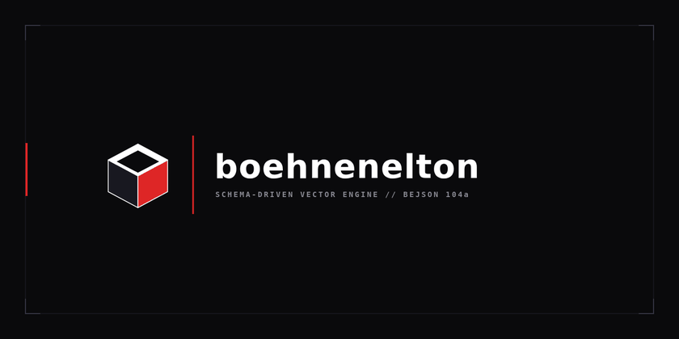
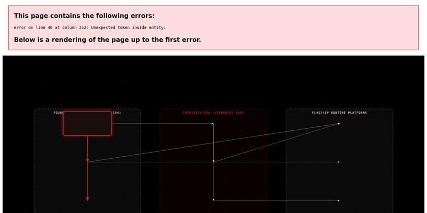
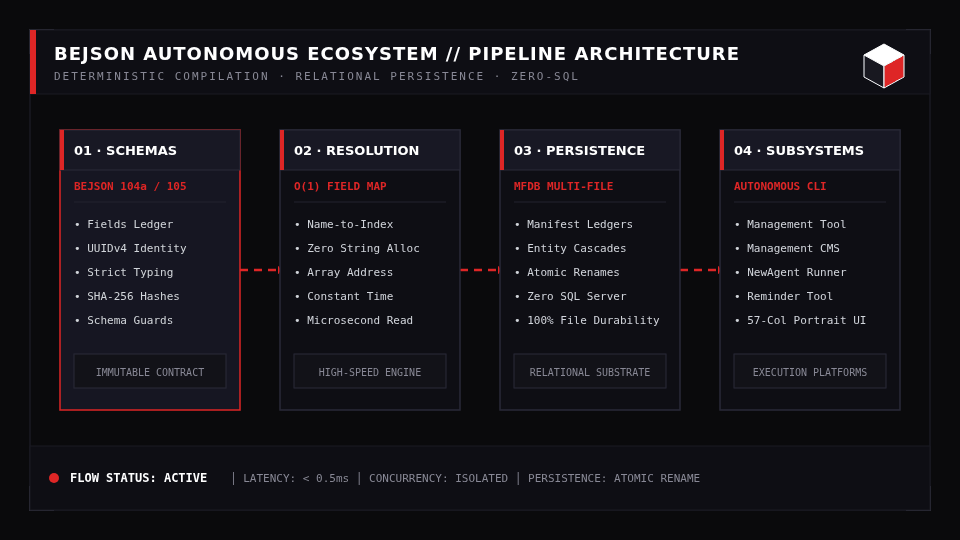
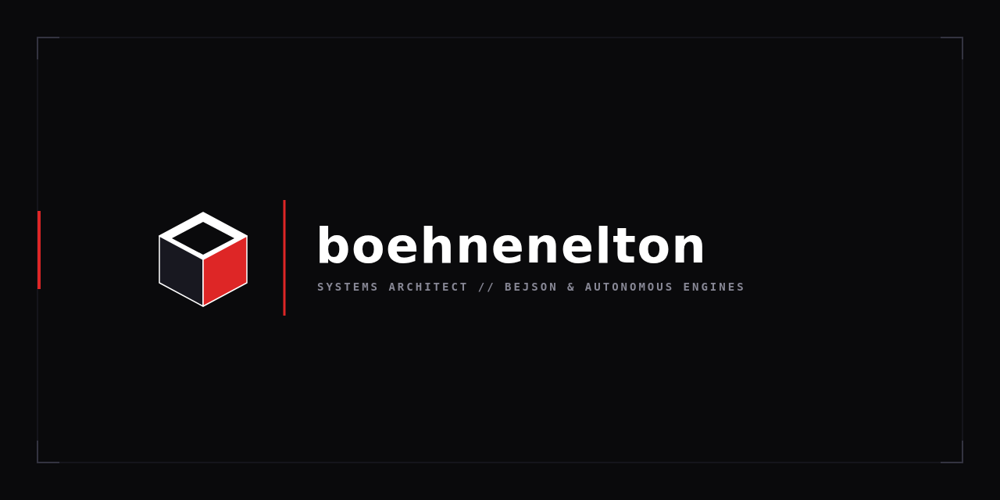
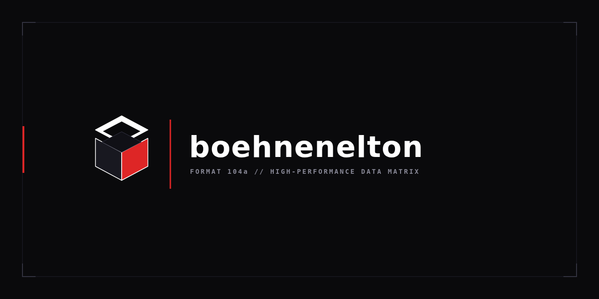
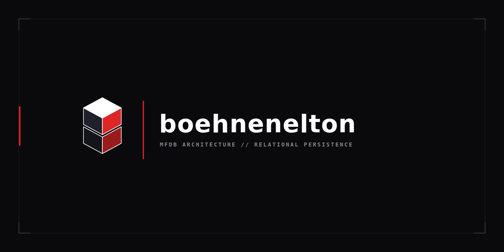
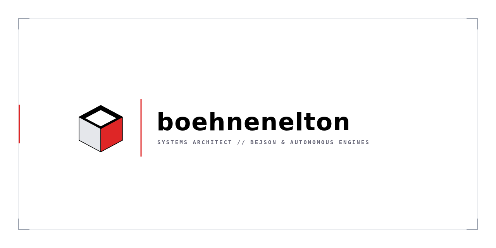

<div align="center">
  
</div>

# Elton Boehnen (`boehnenelton`)

> **Systems Architecture, Deterministic File-Backed Data Formats (`BEJSON 104` / `105` & `MFDB`), Static Content Publishing (`BEJSON_CMS`), and Stateful AI Orchestration (`CLI_AI`).**

<p align="center">
  <a href="#flagship-platform-bejson_cms-file-backed-content-management--publishing-suite"></a>
  <a href="#canonical-standard-libraries-libraries_104--libraries_105"></a>
  <a href="#multi-file-database-mfdb"></a>
  <a href="#57-column-portrait-cli-discipline"></a>
  <a href="https://boehnenelton2024.pages.dev"></a>
  <a href="#license--attribution"></a>
</p>

---

## Table of Contents

- [Overview & Quick Start Setup](#overview--quick-start-setup)
  - [Prerequisites & Environment Setup](#prerequisites--environment-setup)
  - [Quick Start Usage & Asset Compilation](#quick-start-usage--asset-compilation)
- [Flagship Platform: `BEJSON_CMS` (File-Backed Content Management & Publishing Suite)](#flagship-platform-bejson_cms-file-backed-content-management--publishing-suite)
  - [1. Animated `BEJSON_CMS` Architecture & Publishing Pipeline Diagram](#1-animated-bejson_cms-architecture--publishing-pipeline-diagram)
  - [2. Four-Service Flask Topology & `cms-manage.py` CLI Controller](#2-four-service-flask-topology--cms-managepy-cli-controller)
  - [3. Two-Part Page Storage (`site_master` MFDB + `pages_db/`)](#3-two-part-page-storage-site_master-mfdb--pages_db)
  - [4. BKS-1 Four-Part Blog Execution & Graphics 105 Asset Triad](#4-bks-1-four-part-blog-execution--graphics-105-asset-triad)
  - [5. `BEJSON_CMS` Setup, Installation & CLI Usage](#5-bejson_cms-setup-installation--cli-usage)
- [Canonical Standard Libraries (`libraries_104` & `libraries_105`)](#canonical-standard-libraries-libraries_104--libraries_105)
  - [1. Animated `104` & `105` Library Architecture & Upgrade Pipeline Diagram](#1-animated-104--105-library-architecture--upgrade-pipeline-diagram)
  - [2. Era Comparison Matrix (`Foundational 104` vs. `Integrity 105`)](#2-era-comparison-matrix-foundational-104-vs-integrity-105)
  - [3. `libraries_104` Brief Module Inventory (Foundational Era — 19 Families)](#3-libraries_104-brief-module-inventory-foundational-era--19-families)
  - [4. `libraries_105` Brief Module Inventory (Integrity Era — 7 Families)](#4-libraries_105-brief-module-inventory-integrity-era--7-families)
  - [5. Deep Dive: Core, Graphics, Diagrams, Canvas, Taxonomies & CMS Families](#5-deep-dive-core-graphics-diagrams-canvas-taxonomies--cms-families)
  - [6. Polyglot Support: TypeScript, JavaScript & POSIX Shell](#6-polyglot-support-typescript-javascript--posix-shell)
- [System Architecture & Data Flow Pipeline](#system-architecture--data-flow-pipeline)
- [BEJSON Schema-Driven Graphics Engine](#bejson-schema-driven-graphics-engine)
  - [1. The Tabular Schema Specification (`cubic_schema.104a.bejson`)](#1-the-tabular-schema-specification-cubic_schema104abejson)
  - [2. Field Map Cache Resolution](#2-field-map-cache-resolution)
  - [3. Deterministic Vector Compilation Pipeline](#3-deterministic-vector-compilation-pipeline)
- [Authentic Schema Specifications & Data Models](#authentic-schema-specifications--data-models)
  - [1. Diagram Schema Architecture (MFDB-132 Specification)](#1-diagram-schema-architecture-mfdb-132-specification)
  - [2. Animation Schema Architecture (Row-Per-Frame 105a Specification)](#2-animation-schema-architecture-row-per-frame-105a-specification)
  - [3. Canvas Config Schema Specification](#3-canvas-config-schema-specification)
- [Practical Code Patterns & API Usage](#practical-code-patterns--api-usage)
  - [Pattern 1: Initializing a 105 Store with UUIDv4 Identity](#pattern-1-initializing-a-105-store-with-uuidv4-identity)
  - [Pattern 2: Querying & Mutating via Field Map Cache](#pattern-2-querying--mutating-via-field-map-cache)
  - [Pattern 3: Multi-File Database (MFDB) Federation](#pattern-3-multi-file-database-mfdb-federation)
  - [Pattern 4: Compiling Multi-Frame Animations via Graphics Core](#pattern-4-compiling-multi-frame-animations-via-graphics-core)
  - [Pattern 5: Diagram Serialization & MFDB-132 Packaging](#pattern-5-diagram-serialization--mfdb-132-packaging)
- [Core Architectural Pillars](#core-architectural-pillars)
  - [BEJSON 104a & 105 Format Matrix](#bejson-104a--105-format-matrix)
  - [Multi-File Database (MFDB)](#multi-file-database-mfdb)
  - [57-Column Portrait CLI Discipline](#57-column-portrait-cli-discipline)
  - [Tri-Color Visual Palette & Header Design Law](#tri-color-visual-palette--header-design-law)
- [Ecosystem Platforms & Developer Suites](#ecosystem-platforms--developer-suites)
  - [1. `CLI_AI` & `Profile_Chat` — Stateful Gemini Interactions & Multi-Provider Suite](#1-cli_ai--profile_chat--stateful-gemini-interactions--multi-provider-suite)
  - [2. `Management_Tool` — System Maintenance & Notes Hub Suite](#2-management_tool--system-maintenance--notes-hub-suite)
  - [3. `NewAgent` & `JobMaker` — Autonomous Task Workflow Platform](#3-newagent--jobmaker--autonomous-task-workflow-platform)
  - [4. `Project_Manager-V180` — Project Portfolio & Packaging Governor](#4-project_manager-v180--project-portfolio--packaging-governor)
  - [5. `Reminder_Tool` — Priority Terminal Launch Reminders](#5-reminder_tool--priority-terminal-launch-reminders)
- [Cubic Architecture Visual Anchors](#cubic-architecture-visual-anchors)
- [System Error Registry & Quality Gates](#system-error-registry--quality-gates)
- [Technical Specifications & Storage Standards](#technical-specifications--storage-standards)
- [Author & Verification](#author--verification)

---

## Overview & Quick Start Setup

This repository serves as the central architectural hub, visual asset compiler, and profile portal for **Elton Boehnen** (`boehnenelton`). It documents the design principles, data formats, standard libraries (`libraries_104` and `libraries_105`), and production software platforms—led by the flagship **[`BEJSON_CMS`](https://github.com/boehnenelton/BEJSON_CMS)**—developed across the Boehnen software ecosystem.

The ecosystem replaces external database server daemons with portable, deterministic, schema-governed file structures (**BEJSON** and **MFDB**). By combining typed tabular JSON ledgers, dictionary-cached field resolution, zero-dependency Python 3.10+ standard library modules, and bounded task execution pipelines, every tool operates natively across Linux workstations and Android Termux ARM64 environments.

### Prerequisites & Environment Setup

- **Runtime**: Python `3.10+` (standard library core: `json`, `hashlib`, `uuid`, `urllib.request`, `tempfile`, `os`)
- **Optional Visual & Web Dependencies**: `flask` (for `BEJSON_CMS` and `Profile_Chat` web consoles), `playwright` + `Pillow` + `ffmpeg` (for compiling deterministic SVG/GIF architecture diagrams)

```bash
# Clone the profile architecture hub
git clone https://github.com/boehnenelton/boehnenelton.git
cd boehnenelton

# Clone the Flagship BEJSON_CMS platform
git clone https://github.com/boehnenelton/BEJSON_CMS.git

# Clone the CLI_AI & Profile_Chat suite
git clone https://github.com/boehnenelton/CLI_AI.git
```

### Quick Start Usage & Asset Compilation

All animated diagrams and cubic visual anchors embedded in this document are compiled directly from BEJSON schemas located in `assets/` and `dev/`:

```bash
# 1. Compile the static PNG/WebP cubic banners from BEJSON geometry
python3 dev/generate_hub_banners.py

# 2. Compile the animated cubic hero showcase GIF from assets/cubic_schema.104a.bejson
python3 dev/build_bejson_animated_showcase.py

# 3. Compile the animated ecosystem pipeline diagram GIF
python3 dev/generate_animated_diagram.py
```

---

## Flagship Platform: `BEJSON_CMS` (File-Backed Content Management & Publishing Suite)

> **Flagship Repository:** [`github.com/boehnenelton/BEJSON_CMS`](https://github.com/boehnenelton/BEJSON_CMS)  
> **Core Stack:** Python 3.10+, Flask, BEJSON 104 / 105, MFDB (`site_master`), BKS-1 4-Part Writing Engine, Graphics 105 Asset Triad, Static HTML5 / CSS3 / RSS 2.0 Compiler

**[`BEJSON_CMS`](https://github.com/boehnenelton/BEJSON_CMS)** is the **#1 Flagship Application Platform** of the ecosystem. It is a complete, self-hosted **Content Management System, Visual Block-Page Editor, Multi-Stage Technical Blog Authoring Suite, and Static Site Compiler** backed entirely by structured BEJSON `104`/`105` tables and Multi-File Databases (`MFDB`).

### 1. Animated `BEJSON_CMS` Architecture & Publishing Pipeline Diagram

The animated diagram below—constructed with the BEJSON Diagrammer entity schema (`Board`, `Connector`, `Territory`), validated for 40px node clearance and Manhattan routing, and rendered via `lib_bejson_Graphics_graphics_diagram_loader.py`—illustrates the live request routing, two-part page storage, BKS-1 blog generation, and static HTML compilation flow of **`BEJSON_CMS`**:

<div align="center">
  
</div>

*Diagram Artifacts: [`assets/bejson_cms_diagram.json`](assets/bejson_cms_diagram.json) · [`assets/bejson_cms_architecture_diagram.svg`](assets/bejson_cms_architecture_diagram.svg) · [`assets/bejson_cms_diagram_canvas.html`](assets/bejson_cms_diagram_canvas.html)*

---

### 2. Four-Service Flask Topology & `cms-manage.py` CLI Controller

`BEJSON_CMS` isolates administrative concerns into **four dedicated Flask web services** supervised by a unified 57-column CLI controller (`cms-manage.py`):

| Service Module | Default Port | Functional Role | Primary Routes & Actions |
| :--- | :---: | :--- | :--- |
| **`BEJSON_CMS_Admin.py`** | `:5000` | Central site administration console, navigation category editor, media asset registry inspector, and service health monitor. | `/`, `/pages`, `/categories`, `/media`, `/settings`, `/api/status`, `/api/services/control` |
| **`BEJSON_CMS_Publisher.py`** | `:5001` | Static site compiler, BKS-1 4-part technical blog runner, Graphics 105 hero asset binder, and RSS/Atom syndication builder. | `/publish`, `/jobs`, `/preview`, `/api/build/full`, `/api/build/incremental`, `/api/bks/run` |
| **`BEJSON_CMS_PageEditor.py`** | `:5002` | Authoritative visual block-page and HTML/Markdown editor (`v2.3+`) with live preview, template slot binding, and atomic two-part save. | `/editor/<page_uuid>`, `/api/page/load`, `/api/page/save`, `/api/blocks/schema`, `/api/preview/render` |
| **`BEJSON_CMS_ProfileManager.py`** | `:5003` | Author identity registry, session token rotation, role permissions, and AI authoring profile configuration. | `/profiles`, `/auth/login`, `/auth/rotate`, `/api/profile/save`, `/api/author/credits` |
| **`cms-manage.py`** | *CLI* | Process supervisor, MFDB schema validator, atomic backup packager, credential reset tool, and headless static site compiler. | `--start-all`, `--stop-all`, `--status`, `--publish`, `--backup`, `--reset-admin`, `--validate-db` |

---

### 3. Two-Part Page Storage (`site_master` MFDB + `pages_db/`)

To guarantee sub-millisecond category index queries and navigation tree builds even across thousands of published articles, `BEJSON_CMS` implements a **Two-Part Page Storage Architecture** managed by `lib_bejson_CMS_cms_mfdb.py` and `lib_bejson_CMS_cms_core.py`:

1. **Relational Index Tier (`data/site_master.104a.mfdb` → `pagerecord.bejson` & `mediaasset.bejson`)**:
   - Stores compact tabular metadata rows for every page and media asset using BEJSON `104a`/`105a`.
   - Queried via a dictionary Field Map Cache on `page_record_slug_text`, `page_record_category_id`, `page_record_status_flag` (`draft`, `staged`, `published`, `archived`), and `page_record_published_timestamp`.
2. **Document Payload Tier (`data/pages_db/<page_uuid>.json`)**:
   - Stores the full block tree, long-form article HTML/Markdown sections, embedded interactive diagram payloads, and syntax-highlighted code blocks for each page.
   - Loaded into memory only when editing that specific page in `BEJSON_CMS_PageEditor.py` or compiling it during a publish job.

```text
BEJSON_CMS/
├── cms-manage.py                         # Unified 57-column CLI lifecycle & build controller
├── BEJSON_CMS_Admin.py                   # Port 5000: Site administration & MFDB console
├── BEJSON_CMS_Publisher.py               # Port 5001: BKS-1 pipeline & static HTML compiler
├── BEJSON_CMS_PageEditor.py              # Port 5002: Authoritative block & code page editor
├── BEJSON_CMS_ProfileManager.py          # Port 5003: Author profiles & authentication manager
├── config/
│   └── cms_config.104a.bejson            # Site-wide tokens, service ports & route settings
├── data/
│   ├── site_master.104a.mfdb             # Multi-File Database manifest linking CMS entities
│   ├── pagerecord.bejson                 # Tabular index of all site pages & metadata
│   ├── mediaasset.bejson                 # Indexed registry of SVG/PNG/WebP triads & diagrams
│   ├── category_registry.104a.bejson     # Navigation categories (rendered as 2-column wiki grid)
│   └── pages_db/                         # Per-page structured content payloads (<uuid>.json)
├── lib/
│   ├── lib_bejson_CMS_cms_config.py      # Configuration loader & environment pointer resolver
│   ├── lib_bejson_CMS_cms_core.py        # Page CRUD, slug sanitizer & template slot binder
│   ├── lib_bejson_CMS_cms_mfdb.py        # MFDB relational queries & two-tier lock manager
│   └── Writing/                          # BKS-1 4-part blog & manual pipeline modules
└── published_site/                       # Compiled static HTML5, CSS3, assets & feed.xml
```

---

### 4. BKS-1 Four-Part Blog Execution & Graphics 105 Asset Triad

Technical articles in `BEJSON_CMS` are drafted, audited, and compiled through the **BKS-1 Writing Pipeline** (`lib_bejson_Writing_bks_*.py`) paired with the **Graphics 105 Visual Engine**:

- **Stage 1 (`bks_plan.py`)**: Formulates the 4-part article outline, target category classification, and code/diagram slot requirements.
- **Stage 2 (`bks_derive.py`)**: Drafts the 4 structural parts (Part I: Architectural Premise; Part II: Schema Specification; Part III: Implementation Walkthrough; Part IV: Verification & Benchmarks) via `CLI_AI` REST dispatch.
- **Stage 3 (`bks_render.py` & `Graphics 105`)**: Compiles a synchronized **Graphics 105 Asset Triad** (`1280x640` `.svg` vector source, `.png` social card, and `.webp` web banner) and binds them into a 16-sublane editorial HTML layout.
- **Stage 4 (`bks_gates.py`, `bks_store.py` & `bks_export.py`)**: Runs quality gates (link verification, asset presence, functional labeling check) and atomically writes both `pagerecord.bejson` and `pages_db/<uuid>.json`.

---

### 5. `BEJSON_CMS` Setup, Installation & CLI Usage

```bash
# 1. Check service status, MFDB manifest integrity, and indexed page count
python3 cms-manage.py --status

# 2. Start all 4 Flask services (Admin :5000, Publisher :5001, PageEditor :5002, ProfileManager :5003)
python3 cms-manage.py --start-all

# 3. Validate all MFDB entity tables and clear stale lock files
python3 cms-manage.py --validate-db

# 4. Compile the entire site into static HTML5/CSS3/RSS inside published_site/
python3 cms-manage.py --publish --full

# 5. Create a timestamped, SHA-256 verified backup archive of data/ and config/
python3 cms-manage.py --backup
```

---

## Canonical Standard Libraries (`libraries_104` & `libraries_105`)

Every platform in the ecosystem—including `BEJSON_CMS`, `CLI_AI`, `NewAgent`, and `Management_Tool`—is powered by two canonical, era-versioned development library suites (**Release_Version 300**):

- **`libraries_104` (Foundational Era — 19 Families, 90+ Modules)**: Governs Foundational BEJSON `104`, `104a` (schema-registered profiles), `104db` (multi-record streams), and **MFDB v1.31** relational databases.
- **`libraries_105` (Integrity Era — 7 Families, 26 Modules)**: Governs Integrity BEJSON `105`, `105a`, `105db`, and **MFDB v1.40**, adding mandatory **UUIDv4 primary identity minting** at column `0`, per-record **SHA-256 verification digests**, cross-table foreign key cascade enforcement, and the **Graphics 105 / Canvas 105** animation engines.

### 1. Animated `104` & `105` Library Architecture & Upgrade Pipeline Diagram

The animated diagram below illustrates how **Foundational Era (`libraries_104`)** and **Integrity Era (`libraries_105`)** families interconnect—showing the atomic upgrade bridge (`lib_bejson_Core_bejson_upgrade.py`) from `104` to `105` and the downstream consumption by `BEJSON_CMS` and `CLI_AI`:

<div align="center">
  
</div>

*Diagram Artifacts: [`assets/bejson_104_105_diagram.json`](assets/bejson_104_105_diagram.json) · [`assets/bejson_104_105_libraries_diagram.svg`](assets/bejson_104_105_libraries_diagram.svg) · [`assets/bejson_104_105_diagram_canvas.html`](assets/bejson_104_105_diagram_canvas.html)*

---

### 2. Era Comparison Matrix (`Foundational 104` vs. `Integrity 105`)

| Architectural Dimension | `libraries_104` (Foundational Era) | `libraries_105` (Integrity Era) |
| :--- | :--- | :--- |
| **Format Variants** | `104` (single table), `104a` (profile/schema-linked), `104db` (stream) | `105` (UUID base), `105a` (UUID + timeline/profile), `105db` (integrity stream) |
| **MFDB Specification** | **MFDB v1.31** (`104a.mfdb.bejson` manifest + entity table bindings) | **MFDB v1.40** (`105a.mfdb.bejson` manifest + cross-entity UUID foreign-key cascades) |
| **Field Resolution** | Mandatory dictionary Field Map Cache (`{field_name: col_idx}`) | Mandatory dictionary Field Map Cache + permanent field UUID fingerprints |
| **Primary Record Identity** | Application-defined primary key column (`*_id` or `*_guid`) | System-minted **UUIDv4** primary identity at column `0` (`bejson_core_add_record_105`) |
| **Cryptographic Verification** | Structural & primitive schema conformance (`E01`–`E89`) | Per-record **SHA-256 content digest** + tamper detection gates (`E90`–`E95`) |
| **Migration Path** | Native foundational persistence for logs, configs, and fast tables | In-place atomic upgrade from `104` via `lib_bejson_Core_bejson_upgrade.py` |
| **Visual & Layout Engines** | `BEHTML` (8-lane Ry=32px), `HTML` (`html3_*`), `Diagrams` (`diagrams_core`) | `Graphics` (`graphics_core`, `graphics_diagram_loader`) & `Canvas` keyframe timelines |

---

### 3. `libraries_104` Brief Module Inventory (Foundational Era — 19 Families)

All `libraries_104` Python modules follow the canonical 4-part naming convention `lib_bejson_<Family>_<module>.py`:

| # | Family (`libraries_104/Lib_PY/`) | Core Modules (`lib_bejson_<Family>_*.py`) | Concise Functional Summary |
| :-: | :--- | :--- | :--- |
| 1 | **`Core`** | `bejson_core`, `bejson_validator`, `mfdb_core`, `bejson_104db_parser`, `bejson_chunking`, `bejson_core_nesting`, `bejson_env`, `bejson_path_guard`, `bejson_state_management` | Foundational `104`/`104a`/`104db` CRUD, Field Map Cache builders, Two-Tier PathLocking (`RLock` + `.lock`), atomic `.tmp` writes, cell nesting (depth 16), and `definitions.json` resolution. |
| 2 | **`Core_Extension`** | `bejson_pagecache` | In-memory LRU table cache with automatic file `mtime` invalidation for high-frequency reads. |
| 3 | **`AI`** | `chat_interactions_engine`, `bejson_interactions`, `chat_key_rotator`, `gemini_standard_profiles`, `ai_call_logger`, `brain_memory`, `rest_providers` | Stdlib REST clients for Google Gemini Interactions API (`v1beta/interactions`), OpenAI, Anthropic, DeepSeek, and Ollama; 12-key affinity rotation; local context re-seeding; and 80k-token context bubble governance. |
| 4 | **`CMS`** | `cms_config`, `cms_core`, `cms_mfdb` | Configuration loader, two-part page CRUD (`pagerecord.bejson` + `pages_db/`), slug sanitization, and `site_master` MFDB driver for `BEJSON_CMS`. |
| 5 | **`Writing`** | `bks_plan`, `bks_derive`, `bks_render`, `bks_store`, `bks_export`, `bks_gates` | The **BKS-1** 4-part technical blog and manual authoring pipeline: planning, section derivation, HTML/BEHTML rendering, quality gates, and static export. |
| 6 | **`BEHTML`** | `behtml_core`, `behtml_layout`, `behtml_collision`, `behtml_validator`, `behtml_compiler` | Deterministic **8-lane / 16-sublane** spatial UI grid engine with **Ry=32px vertical quantization** and 18-field element validation. |
| 7 | **`BEHTML_IDE`** | `behtml_ide_server`, `behtml_ide_canvas`, `behtml_ide_inspector` | Visual browser canvas and coordinate inspector for authoring BEHTML layouts. |
| 8 | **`HTML`** | `html3_core`, `html3_components`, `html3_diagrams`, `html3_tables`, `html3_themes` | Tri-Color (`#000000`, `#FFFFFF`, `#DE2626`) HTML5 UI builders, responsive cards, overflow dock strips, and embeddable diagram tabs. |
| 9 | **`Diagrams`** | `diagrams_core`, `diagrams_validator`, `diagrams_ai` | Entity-based diagram modeler (`Board`, `Connector`, `Territory`), Manhattan router, 40px clearance validator, and `.mfdb132.bejson` packager. |
| 10 | **`Chunker`** | `mfdb_chunker_v5`, `mfdb_chunker_v6` | Collapses multi-file repositories and MFDB trees into portable single-file `.bejson` / `.mfdb132.bejson` containers. |
| 11 | **`Projects`** | `projects_tracker`, `projects_archive`, `projects_locks`, `projects_pipeline`, `projects_zip` | Governs solid integer package versions (`Name_Case-V#-PKG#`), `bejson_project.json` manifests, and release ZIP builds. |
| 12 | **`Bookmaker`** | `bookmaker_core`, `bookmaker_chapters`, `bookmaker_glossary`, `bookmaker_epub` | Multi-chapter technical book and documentation portal compiler with automated glossaries and drawer navigation. |
| 13 | **`Cognition`** | `cognition_patterns`, `cognition_nuance`, `cognition_synthesis` | Extracts conceptual archetypes, architectural tradeoffs, and nuance registries from engineering notes. |
| 14 | **`ExpCMS`** | `expcms_router`, `expcms_widgets`, `expcms_feeds` | Modular category feed routers, wiki-style 2-column category link grids, and editorial widget shelves. |
| 15 | **`Gaming`** | `gaming_state`, `gaming_grid`, `gaming_loop` | Turn-based state machines and 2D grid coordinate persistence stored in BEJSON `104a`. |
| 16 | **`Lists`** | `lists_core`, `lists_filter`, `lists_export` | Priority queues, reminder registries, and sorted tabular list operations. |
| 17 | **`MD`** | `md_parser`, `md_renderer`, `md_toc` | GitHub-Flavored Markdown AST parser, HTML renderer, and Table of Contents generator. |
| 18 | **`System`** | `system_jobs`, `system_hierarchy`, `system_logs`, `system_maintenance` | Standing maintenance job registries, 4-Tier directory hierarchy drift auditing (`.path.bejson`), and daily telemetry logs. |
| 19 | **`Utility`** | `utility_cli`, `utility_tui`, `utility_sanitization`, `utility_crypto` | 57-column portrait CLI formatters, ANSI arrow-key TUI menus, boundary string sanitization, and AES-GCM helpers. |

---

### 4. `libraries_105` Brief Module Inventory (Integrity Era — 7 Families)

`libraries_105` provides **26 Integrity Era modules** across **7 domain families**:

| # | Family (`libraries_105/Lib_PY/`) | Core Modules (`lib_bejson_<Family>_*.py`) | Concise Functional Summary |
| :-: | :--- | :--- | :--- |
| 1 | **`Core`** | `bejson_core` (`v3.6.0`), `bejson_validator`, `bejson_upgrade`, `mfdb_core` (`v1.40`) | Format `105`/`105a`/`105db` CRUD with column-0 **UUIDv4 minting**, per-record **SHA-256 digests**, `E90`–`E95` tamper validation, **MFDB v1.40** FK cascades, and atomic `104 → 105` migration. |
| 2 | **`Graphics`** | `graphics_core` (`v1.1.0`), `graphics_schemas`, `graphics_canvas_templates`, `graphics_diagram_loader`, `graphics_validator` | Compiles `105a` vector primitives, isometric cubes, and row-per-frame timelines into SVG, PNG, WebP, and animated GIF assets; bridges `Diagrams` models into animated canvases. |
| 3 | **`Canvas`** | `canvas_schemas`, `canvas_templates` | Spatial coordinate matrices and procedural pattern generators (Isometric Cube 128px, Circuit Grid 64px, Checkerboard 64px). |
| 4 | **`CMS`** | `mtv_core`, `mtv_scaffold`, `mtv_validator` | Model-Template-View (`MTV`) schema binding and content safety validators for `BEJSON_CMS` 105 stores. |
| 5 | **`Standards`** | `standards_core`, `standards_registry`, `standards_state`, `standards_export`, `standards_validator` | Machine-verifiable code standards registries, AST compliance rules, and audit report exporters. |
| 6 | **`Tax_Scaffolds`** | `tax_scaffolds_core`, `tax_scaffolds_scaffold`, `tax_scaffolds_validator` | Scaffolds and validates `<hierarchy>_<group>_<purpose>` column taxonomies and relational table templates. |
| 7 | **`Taxonomies`** | `taxonomies_core`, `taxonomies_registry`, `taxonomies_validator` | Central symbol, entity prefix, and category classification registries with collision detection. |

---

### 5. Deep Dive: Core, Graphics, Diagrams, Canvas, Taxonomies & CMS Families

```text
+-----------------------------------------------------------------------------------------+
|                              CANONICAL LIBRARY ECOSYSTEM                                |
+----------------------------+----------------------------+-------------------------------+
|  1. CORE FAMILY            |  2. GRAPHICS & CANVAS      |  3. DIAGRAMS FAMILY           |
|  - bejson_core (v3.6.0)    |  - graphics_core (v1.1.0)  |  - diagrams_core (v1.2.0)     |
|  - mfdb_core (v1.40)       |  - graphics_schemas        |  - diagrams_validator         |
|  - bejson_validator        |  - graphics_diagram_loader |  - diagrams_ai                |
|  - bejson_upgrade          |  - canvas_templates        |  - mfdb132_packaging          |
|  - bejson_core_nesting     |  - canvas_schemas          |  - board_connector_territory  |
|  - bejson_chunking         |  - blank_slate_stages      |  - manhattan_orthogonal_route |
+----------------------------+----------------------------+-------------------------------+
|  4. TAXONOMY & SCAFFOLDS   |  5. CMS & WRITING FAMILY   |  6. POLYGLOT CORE             |
|  - schema_taxonomies       |  - cms_core / cms_mfdb     |  - Lib_TS (TypeScript Core)   |
|  - tax_scaffolds_core      |  - mtv_core / mtv_scaffold |  - Lib_JS (Web Crypto Node)   |
|  - standards_registry      |  - bks_plan..bks_export    |  - Lib_SH (POSIX Shell CLI)   |
+----------------------------+----------------------------+-------------------------------+
```

#### Core Family (`lib_bejson_Core_*`)
- **`lib_bejson_Core_bejson_core.py` (v3.6.0)**:
  - Atomic file operations via `bejson_core_atomic_write` using sibling tempfile buffers, `os.fsync`, and `os.replace` rename guards.
  - Self-validating Field Map Cache with live document layout fingerprints.
  - Format 105 UUIDv4 primary identity minting per record (`bejson_core_add_record_105`).
  - Dual-key coordinate-healing cell writes (`bejson_core_write_cell`).
- **`lib_bejson_Core_mfdb_core.py` (v1.40)**:
  - Multi-File Database coordinator loading and verifying manifests (`104a.mfdb.bejson` and `105a.mfdb.bejson`).
  - Enforces cross-entity relational cascades (`ON DELETE CASCADE`, `ON DELETE SET NULL`, `ON DELETE RESTRICT`) and in-memory joins across partitioned files.
- **`lib_bejson_Core_bejson_validator.py` & `lib_bejson_Core_bejson_upgrade.py`**:
  - Deterministic structural conformance testing against error codes `E01`–`E95` and in-place atomic upgrades from Format `104` to Format `105`.

#### Graphics & Diagrams Families (`lib_bejson_Graphics_*` & `lib_bejson_Diagrams_*`)
- **`lib_bejson_Graphics_graphics_core.py` (v1.1.0)** & **`lib_bejson_Graphics_graphics_diagram_loader.py`**:
  - Native Playwright SVG capture engine, row-per-frame animation controller (`create_row_per_frame_animation_105a`), procedural 3D isometric cube generator (`create_isometric_cube_svg`), and interactive HTML5/SVG diagram renderer (`render_diagram_svg`).
- **`lib_bejson_Diagrams_diagrams_core.py` (v1.2.0)** & **`lib_bejson_Diagrams_diagrams_validator.py`**:
  - Canonical diagram entity definitions (`BOARD_BASE_FIELDS`, `CONNECTOR_BASE_FIELDS`, `TERRITORY_BASE_FIELDS`, `SHAPE_BASE_FIELDS`), pre-validation (`validatePlanSemantics`), 40px bounding-box clearance checks (`validateDiagram`), auto-remediation (`remediateDiagram`), and single-file `.mfdb132.bejson` packaging.

### 6. Polyglot Support: TypeScript, JavaScript & POSIX Shell
- **`Lib_TS/Core`**: Full TypeScript declarations (`BEJSONDocument<T>`, `MFDBManifest`, `FieldMapCache`) for Node.js and Bun runtimes.
- **`Lib_JS/Core`**: Browser and Node.js implementation utilizing the standard Web Crypto API for zero-dependency AES-GCM and SHA-256 operations.
- **`Lib_SH/Core`**: Pure POSIX Shell / Bash utility library with embedded JSON schema validation using `jq` and `awk`.

---

## System Architecture & Data Flow Pipeline

<div align="center">
  
</div>

The ecosystem coordinates workloads across four deterministic execution stages:

1. **01 · Schemas (`BEJSON 104a / 105`)**: Immutable contract ledgers defining field types, column coordinates, UUIDv4 fingerprints, and cryptographic SHA-256 validation digests.
2. **02 · Resolution (`Field Map Cache`)**: Zero-allocation dictionary compilation that maps column names to integer tuple indices on initial load for constant-time slice reads.
3. **03 · Persistence (`MFDB Multi-File`)**: Relational database federation linking multiple flat-file tables through atomic rename locks without an external database daemon.
4. **04 · Subsystems (`Execution Platforms`)**: Clean dispatch layer routing workloads into **`BEJSON_CMS`**, **`CLI_AI`**, **`NewAgent`**, **`Management_Tool`**, and **`Reminder_Tool`**.

---

## BEJSON Schema-Driven Graphics Engine

Visual assets, architecture diagrams, and cubic branding anchors across this repository are compiled directly from structured BEJSON tabular schemas.

### 1. The Tabular Schema Specification (`cubic_schema.104a.bejson`)

Every vertex of the 3D isometric cube, the floating top diamond cap, the focal red divider, and the stage boundaries in [`assets/boehnenelton_cubic_engine.gif`](assets/boehnenelton_cubic_engine.gif) are stored as rows in [`assets/cubic_schema.104a.bejson`](assets/cubic_schema.104a.bejson):

```json
{
  "Header": {
    "Table_Name": "cubic_graphic_primitives",
    "Format": "104a",
    "Record_Count": 7,
    "Author": "Elton Boehnen",
    "Description": "BEJSON 104a tabular vector graphic schema defining the canonical 3D isometric open branding cube and stage coordinates."
  },
  "Fields": [
    "element_id",
    "primitive_type",
    "points_or_coords",
    "fill_color",
    "stroke_color",
    "stroke_width",
    "animation_mode",
    "semantic_label"
  ],
  "Data": [
    ["elem_01_substrate",   "rect",    "0,0,1280,640",              "#0A0A0C", "none",    0.0, "static",         "Canvas Obsidian Substrate"],
    ["elem_02_frame",       "rect",    "48,48,1184,544",            "none",    "#1A1A22", 1.5, "static",         "Structural Inset Boundary Frame"],
    ["elem_03_notch",       "rect",    "48,270,4,100",              "#DE2626", "none",    0.0, "static",         "Left Boundary Accent Notch"],
    ["elem_04_divider",     "line",    "364,256,364,404",           "none",    "#DE2626", 3.0, "pulse_alpha",    "Primary Red Focal Divider"],
    ["elem_05_floating_cap","polygon", "0,-48,56,-18,0,12,-56,-18", "#FFFFFF", "#FFFFFF", 1.5, "harmonic_float", "104a Hovering Diamond Cap"],
    ["elem_06_left_facet",  "polygon", "-56,-18,0,12,0,72,-56,42",  "#181820", "#FFFFFF", 1.5, "static",         "Left Obsidian Shading Facet"],
    ["elem_07_right_facet", "polygon", "0,12,56,-18,56,42,0,72",   "#DE2626", "#FFFFFF", 1.5, "static",         "Right Signature Red Facet"]
  ]
}
```

### 2. Field Map Cache Resolution

To prevent fragile positional indexing (`row[3]`) or repeated linear scans across animation frames, the renderer builds a dictionary Field Map Cache upon loading the schema:

```python
# Build Field Map Cache once prior to row iteration
fields_list = bejson_doc["Fields"]
field_map = {field_name: column_idx for column_idx, field_name in enumerate(fields_list)}

# Direct named column addressability inside hot render loops
col_type   = field_map["primitive_type"]
col_coords = field_map["points_or_coords"]
col_fill   = field_map["fill_color"]
col_stroke = field_map["stroke_color"]
col_width  = field_map["stroke_width"]
col_anim   = field_map["animation_mode"]
```

### 3. Deterministic Vector Compilation Pipeline

The renderer iterates rows via the Field Map Cache, computes harmonic vertical offsets for `harmonic_float` primitives, and emits standalone SVG markup:

```python
def compile_bejson_to_svg(bejson_doc: dict, time_sec: float = 0.0) -> str:
    """Compiles BEJSON 104a tabular graphic rows into deterministic SVG markup."""
    field_map = {name: idx for idx, name in enumerate(bejson_doc["Fields"])}
    rendered_elements = []

    for row in bejson_doc["Data"]:
        p_type = row[field_map["primitive_type"]]
        coords = row[field_map["points_or_coords"]]
        fill   = row[field_map["fill_color"]]
        stroke = row[field_map["stroke_color"]]
        width  = row[field_map["stroke_width"]]
        anim   = row[field_map["animation_mode"]]

        if anim == "harmonic_float":
            y_offset = -22.0 * math.sin(time_sec * 2.0 * math.pi)
            rendered_elements.append(
                f'<g transform="translate(0, {y_offset:.2f})">'
                f'<polygon points="{coords}" fill="{fill}" stroke="{stroke}" stroke-width="{width}"/>'
                f'</g>'
            )
        elif p_type == "polygon":
            rendered_elements.append(
                f'<polygon points="{coords}" fill="{fill}" stroke="{stroke}" stroke-width="{width}"/>'
            )
        elif p_type == "rect":
            x_pos, y_pos, width_px, height_px = coords.split(",")
            rendered_elements.append(
                f'<rect x="{x_pos}" y="{y_pos}" width="{width_px}" height="{height_px}" fill="{fill}" stroke="{stroke}" stroke-width="{width}"/>'
            )
        elif p_type == "line":
            x1_pos, y1_pos, x2_pos, y2_pos = coords.split(",")
            rendered_elements.append(
                f'<line x1="{x1_pos}" y1="{y1_pos}" x2="{x2_pos}" y2="{y2_pos}" stroke="{stroke}" stroke-width="{width}"/>'
            )

    return f'<svg width="1280" height="640">{"".join(rendered_elements)}</svg>'
```

---

## Authentic Schema Specifications & Data Models

### 1. Diagram Schema Architecture (MFDB-132 Specification)

A BEJSON architecture diagram is modeled as an MFDB relational database comprising three core entity tables (`Board`, `Connector`, `Territory`) coordinated by a master manifest:

#### Master Manifest (`104a.mfdb.bejson`)
```json
{
  "Header": {
    "Database_Name": "system_architecture_diagram",
    "Format": "104a.mfdb",
    "Version": "1.31",
    "Author": "Elton Boehnen",
    "Relational_ID": "c9f8e7d6-c5b4-4321-8765-43210fe98765"
  },
  "Entities": [
    {
      "name": "Board",
      "file": "Board.104.bejson",
      "primary_key": "shape_id",
      "record_count": 4
    },
    {
      "name": "Connector",
      "file": "Connector.104.bejson",
      "primary_key": "conn_id",
      "record_count": 3
    },
    {
      "name": "Territory",
      "file": "Territory.104.bejson",
      "primary_key": "terr_id",
      "record_count": 1
    }
  ]
}
```

#### Board Entity Schema (`BOARD_BASE_FIELDS`)
```json
{
  "Header": {
    "Table_Name": "Board",
    "Format": "104",
    "Record_Count": 4
  },
  "Fields": [
    "shape_id",
    "shape_entity_name",
    "shape_cx",
    "shape_cy",
    "shape_size_class",
    "shape_kind",
    "shape_parent_fk",
    "shape_collapsed"
  ],
  "Data": [
    ["shape_01", "Schema_Registry",    150, 270, "medium", "rect", null, false],
    ["shape_02", "Field_Map_Engine",   370, 270, "medium", "rect", null, false],
    ["shape_03", "MFDB_Persistence",   590, 270, "medium", "rect", null, false],
    ["shape_04", "Subsystem_Routers",  810, 270, "medium", "rect", null, false]
  ]
}
```

#### Connector Entity Schema (`CONNECTOR_BASE_FIELDS`)
```json
{
  "Header": {
    "Table_Name": "Connector",
    "Format": "104",
    "Record_Count": 3
  },
  "Fields": [
    "conn_id",
    "conn_from_fk",
    "conn_to_fk",
    "conn_flow"
  ],
  "Data": [
    ["conn_01_02", "shape_01", "shape_02", "forward"],
    ["conn_02_03", "shape_02", "shape_03", "forward"],
    ["conn_03_04", "shape_03", "shape_04", "forward"]
  ]
}
```

### 2. Animation Schema Architecture (Row-Per-Frame 105a Specification)

In `lib_bejson_Graphics_graphics_schemas.py`, a multi-frame animation sequence is declared as an Integrity Era `105a` table where every row represents a discrete rendering frame verified by a SHA-256 digest:

```json
{
  "Header": {
    "Table_Name": "pulse_cube_animation",
    "Format": "105a",
    "Record_Count": 24,
    "Author": "Elton Boehnen",
    "Relational_ID": "9b2c3d4e-2222-4000-8000-000000000000",
    "Duration_Sec": 2.0,
    "FPS": 12,
    "Width_Px": 960,
    "Height_Px": 540
  },
  "Fields": [
    {"name": "frame_index",      "type": "integer", "field_uuid": "9b2c3d4e-2222-4000-8000-000000000001"},
    {"name": "timestamp_sec",    "type": "number",  "field_uuid": "9b2c3d4e-2222-4000-8000-000000000002"},
    {"name": "seek_progress",    "type": "number",  "field_uuid": "9b2c3d4e-2222-4000-8000-000000000003"},
    {"name": "fps",              "type": "integer", "field_uuid": "9b2c3d4e-2222-4000-8000-000000000004"},
    {"name": "frame_filename",   "type": "string",  "field_uuid": "9b2c3d4e-2222-4000-8000-000000000005"},
    {"name": "svg_markup",       "type": "string",  "field_uuid": "9b2c3d4e-2222-4000-8000-000000000006"},
    {"name": "frame_data_json",  "type": "string",  "field_uuid": "9b2c3d4e-2222-4000-8000-000000000007"},
    {"name": "is_rendered",      "type": "boolean", "field_uuid": "9b2c3d4e-2222-4000-8000-000000000008"},
    {"name": "checksum_sha256",  "type": "string",  "field_uuid": "9b2c3d4e-2222-4000-8000-000000000009"}
  ],
  "Data": [
    [
      "a1b2c3d4-0000-4000-8000-000000000001",
      0,
      0.000,
      0.000,
      12,
      "frame_0000.png",
      "<svg>...</svg>",
      "{\"y_float\": 0.0, \"pulse\": 1.0}",
      true,
      "e3b0c44298fc1c149afbf4c8996fb92427ae41e4649b934ca495991b7852b855"
    ],
    [
      "a1b2c3d4-0000-4000-8000-000000000002",
      1,
      0.083,
      0.041,
      12,
      "frame_0001.png",
      "<svg>...</svg>",
      "{\"y_float\": -5.5, \"pulse\": 0.95}",
      true,
      "5feceb66ffc86f38d952786c6d696c79c2dbc239dd4e91b46729d73a27fb57e9"
    ]
  ]
}
```

### 3. Canvas Config Schema Specification

The `GRAPHIC_CANVAS_CONFIG_FIELDS` contract standardizes stage geometry across all Graphics 105 tools:

| Field Name | Type | Permanent Field UUID | Functional Purpose |
|---|---|---|---|
| `canvas_id` | `string` | `9a1b2c3d-1111-4000-8000-000000000001` | Unique stage instance identifier |
| `template_name` | `string` | `9a1b2c3d-1111-4000-8000-000000000002` | Reference to blank-slate HTML template |
| `stage_selector`| `string` | `9a1b2c3d-1111-4000-8000-000000000003` | CSS target DOM selector (`#stage-root`) |
| `width_px` | `integer` | `9a1b2c3d-1111-4000-8000-000000000004` | Canvas horizontal pixel width |
| `height_px` | `integer` | `9a1b2c3d-1111-4000-8000-000000000005` | Canvas vertical pixel height |
| `aspect_ratio` | `string` | `9a1b2c3d-1111-4000-8000-000000000006` | Ratio invariant (`1:1`, `16:9`, `2:1`) |
| `bg_theme` | `string` | `9a1b2c3d-1111-4000-8000-000000000007` | Canvas theme (`dark_obsidian`, `light_white`) |
| `accent_color` | `string` | `9a1b2c3d-1111-4000-8000-000000000008` | Primary accent color (`#DE2626`) |
| `device_scale` | `integer` | `9a1b2c3d-1111-4000-8000-000000000009` | Device pixel ratio (`1` for 1x, `2` for Retina) |
| `output_dir` | `string` | `9a1b2c3d-1111-4000-8000-000000000010` | Destination frame export folder |
| `text_overlays_json`|`string`| `9a1b2c3d-1111-4000-8000-000000000011`| Serialized list of text overlays |
| `remove_frame_source`|`boolean`|`9a1b2c3d-1111-4000-8000-000000000012`| Auto-cleanup temporary SVG frames after render |

---

## Practical Code Patterns & API Usage

### Pattern 1: Initializing a 105 Store with UUIDv4 Identity

```python
from lib_bejson_Core_bejson_core import (
    bejson_core_create_document,
    bejson_core_define_field,
    bejson_core_add_record_105,
    bejson_core_atomic_write,
)

# 1. Initialize Format 105 document
telemetry_doc = bejson_core_create_document(
    table_name="telemetry_metrics",
    format_version="105",
    author="Elton Boehnen"
)

# 2. Define schema fields with eager type validation
bejson_core_define_field(telemetry_doc, field_name="metric_name", field_type="string")
bejson_core_define_field(telemetry_doc, field_name="metric_value", field_type="number")
bejson_core_define_field(telemetry_doc, field_name="is_active", field_type="boolean")

# 3. Add record: automatically mints UUIDv4 at column 0
minted_record_uuid = bejson_core_add_record_105(
    telemetry_doc,
    values=["cpu_utilization_ratio", 0.42, True]
)

# 4. Persist with atomic tempfile + rename guarantee
bejson_core_atomic_write(telemetry_doc, "data/telemetry_metrics.105.bejson")
```

### Pattern 2: Querying & Mutating via Field Map Cache

```python
import logging
from lib_bejson_Core_bejson_core import (
    bejson_core_load_file,
    bejson_core_get_field_map,
    bejson_core_write_cell,
    bejson_core_atomic_write,
)

# Load document: Field Map Cache is warmed on ingestion
telemetry_doc = bejson_core_load_file("data/telemetry_metrics.105.bejson")
field_map = bejson_core_get_field_map(telemetry_doc)

# Named column resolution across records
metric_value_col_idx = field_map["metric_value"]
for record_row in telemetry_doc["Data"]:
    if record_row[metric_value_col_idx] > 0.80:
        logging.info("High utilization metric: %s", record_row[metric_value_col_idx])

# Dual-key cell mutation: self-healing against column coordinate shifts
bejson_core_write_cell(
    telemetry_doc,
    row_idx=0,
    field_identifier="metric_value",
    new_value=0.55
)
bejson_core_atomic_write(telemetry_doc, "data/telemetry_metrics.105.bejson")
```

### Pattern 3: Multi-File Database (MFDB) Federation

```python
from lib_bejson_Core_mfdb_core import (
    mfdb_core_create_database,
    mfdb_core_register_entity,
    mfdb_core_query_relation,
)

# Initialize master manifest (104a.mfdb.bejson)
mfdb_core_create_database(
    db_name="cms_site_master",
    author="Elton Boehnen",
    db_root="data/mfdb"
)

# Register relational entity tables with foreign key cascades
mfdb_core_register_entity(
    db_root="data/mfdb",
    entity_name="Categories",
    table_filename="Categories.104.bejson",
    primary_key="category_id"
)
mfdb_core_register_entity(
    db_root="data/mfdb",
    entity_name="Pages",
    table_filename="Pages.104.bejson",
    primary_key="page_id",
    foreign_keys=[{"field": "category_fk", "target_entity": "Categories", "on_delete": "CASCADE"}]
)
```

### Pattern 4: Compiling Multi-Frame Animations via Graphics Core

```python
from lib_bejson_Graphics_graphics_core import (
    create_row_per_frame_animation_105a,
    create_isometric_cube_svg,
    render_animation_to_gif,
)

# 1. Initialize 24-frame animation controller
animation_doc = create_row_per_frame_animation_105a(
    animation_name="cube_rotation",
    duration_sec=2.0,
    fps=12,
    width_px=960,
    height_px=540
)

# 2. Populate frames with procedural vector geometry
for frame_index in range(24):
    seek_progress = frame_index / 24.0
    frame_svg = create_isometric_cube_svg(
        viewbox_size=540,
        cube_style="104a_floating",
        pulse_intensity=1.0 + (0.3 * seek_progress)
    )
    animation_doc["Data"].append([
        f"frame_{frame_index:04d}",
        frame_index,
        seek_progress * 2.0,
        seek_progress,
        12,
        f"frame_{frame_index:04d}.png",
        frame_svg,
        "{}",
        False,
        ""
    ])

# 3. Render directly to animated GIF using Playwright and Pillow
render_animation_to_gif(animation_doc, output_path="assets/cube_rotation.gif")
```

### Pattern 5: Diagram Serialization & MFDB-132 Packaging

```python
from pathlib import Path
from lib_bejson_Diagrams_diagrams_core import (
    diagrams_core_create_mfdb132_package_from_model,
    diagrams_core_extract_diagram_model_from_mfdb132,
)

diagram_model = {
    "diagramId": "diag_cms_01",
    "name": "CMS Service Topology",
    "shapes": [
        {"id": "n1", "label": "BEJSON_CMS_Admin", "cx": 200, "cy": 150, "kind": "rect", "color": "#181820"},
        {"id": "n2", "label": "BEJSON_CMS_PageEditor", "cx": 500, "cy": 150, "kind": "rect", "color": "#DE2626"}
    ],
    "connectors": [
        {"id": "c1", "from": "n1", "to": "n2", "flow": "forward"}
    ],
    "territories": []
}

# Pack entire diagram into a single-file portable MFDB-132 container
package_bytes = diagrams_core_create_mfdb132_package_from_model(diagram_model)
Path("cms_service_topology.mfdb132.bejson").write_bytes(package_bytes)
```

---

## Core Architectural Pillars

### BEJSON 104a & 105 Format Matrix

```text
+-------------------------------------------------------------------------+
| FOUNDATIONAL ERA (Format 104 / 104a / 104db)                           |
| - Header metadata + 1D 'Fields' schema array + 2D tabular 'Data' rows   |
| - Dictionary Field Map Cache for named column resolution                |
| - Format 104: Core single-table structured file                         |
| - Format 104a: Dynamic schema registry integration                      |
| - Format 104db: Relational multi-table entity bindings                  |
+-------------------------------------------------------------------------+
| INTEGRITY ERA (Format 105 / 105a / 105db)                               |
| - UUIDv4 primary identity minting per record at column 0                |
| - Cryptographic SHA-256 record verification digests                     |
| - Cross-entity relational cascades and foreign-key integrity             |
+-------------------------------------------------------------------------+
```

### Multi-File Database (MFDB)

MFDB federates multiple independent tabular entity files into a relational database stored directly on disk:
- **Manifest-Driven**: Master manifest documents (`104a.mfdb.bejson` and `105a.mfdb.bejson`) register entities, schemas, primary keys, and relative table paths.
- **Atomic Operations**: Mutations write through sibling temporary files, flush via `os.fsync`, and execute atomic `os.replace` renames to prevent partial writes.
- **Git-Friendly Portability**: Every database consists of human-readable JSON tables that can be inspected, diffed, backed up, or packed into a single `.mfdb132.bejson` container.

### 57-Column Portrait CLI Discipline

Every command-line tool in the ecosystem enforces a strict **57-column maximum line width** engineered for mobile touchscreens, Android Termux portrait terminals, and vertical split panes:

```text
=========================================================
 BEJSON_CMS LIFECYCLE CONTROLLER           v2.4 · PKG100
=========================================================
 [SERVICE]                 [PORT]   [PID]    [STATUS]
 --------------------------------------------------------
 BEJSON_CMS_Admin           5000     14820    ONLINE
 BEJSON_CMS_Publisher       5001     14824    ONLINE
 BEJSON_CMS_PageEditor      5002     14829    ONLINE
 BEJSON_CMS_ProfileManager  5003     14833    ONLINE
 --------------------------------------------------------
 MFDB Manifest : site_master.104a.mfdb       (VERIFIED)
 Pages Indexed : 142 records                 (0 LOCKS)
 Media Triads  : 88 SVG/PNG/WebP sets        (SYNCED)
=========================================================
 [1] Publish Site  [2] Backup DB  [3] Logs  [Q] Quit
=========================================================
```

### Tri-Color Visual Palette & Header Design Law

All web interfaces, static publications, SVG diagrams, and terminal outputs enforce strict visual invariants:
- **Pitch Black (`#0A0A0C` / `#000000`)**: Primary high-contrast dark canvas substrate.
- **Pure White (`#FFFFFF`)**: High-legibility typography and structural borders.
- **Signature Vivid Red (`#DE2626`)**: Directional dividers, active highlights, data-flow pulses, and cubic accents.
- **Header Design Law**: Web headers contain at most `[Hamburger Drawer Button] [App Title (<= 3 Words)] [Settings Overlay Cog]`, with secondary utilities placed on a horizontal overflow dock strip immediately below the header.

---

## Ecosystem Platforms & Developer Suites

```text
                           +-------------------------+
                           |      boehnenelton       |
                           |  Ecosystem Master Hub   |
                           +------------+------------+
                                        |
        +------------------+------------+------------+------------------+
        |                  |                         |                  |
+-------v------+   +-------v------+          +-------v------+   +-------v------+
|  BEJSON_CMS  |   |    CLI_AI    |          |   NewAgent   |   |  Management  |
|   Flagship   |   | Profile_Chat |          |  JobMaker &  |   |     Tool     |
|  Publishing  |   | Interactions |          | Agent Suite  |   |  Maintenance |
+--------------+   +--------------+          +--------------+   +--------------+
        |                  |                         |                  |
+-------v------+   +-------v------+          +-------v------+   +-------v------+
| BKS-1 Blog & |   | 12-Key Pool  |          |   Project    |   |   Reminder   |
| PageEditor   |   | & Web Canvas |          | Manager V180 |   |     Tool     |
+--------------+   +--------------+          +--------------+   +--------------+
```

### 1. `CLI_AI` & `Profile_Chat` — Stateful Gemini Interactions & Multi-Provider Suite
- **Repository**: [`CLI_AI`](https://github.com/boehnenelton/CLI_AI)
- **Role**: Multi-provider AI CLI and web workspace (`ProfileChat-Standard.py`) powered by the Google Gemini Interactions API (`v1beta/interactions`).
- **Key Capabilities**:
  - **Server-Side Conversation Chaining (`previous_interaction_id`)**: Tracks multi-turn stateful conversations through `lib_bejson_AI_chat_interactions_engine.py` and `lib_bejson_AI_interactions_bubble.py`.
  - **Session Key Affinity & Cross-Key Local Context Re-Seeding**: Pins active sessions to the originating API key (`preferred_api_key`). When a key rotates across the 12-key pool (`ENV:GEMINI_KEY_1..12`) due to rate limits (`HTTP 429`), the engine automatically drops the previous key's `previous_interaction_id` and re-seeds the new interaction from locally persisted BEJSON session history (`local_history`).
  - **Web Preview Canvas & Gitignored Telemetry**: Includes a live HTML/SVG preview canvas (`#view-canvas`), `google_search` grounding, `code_execution`, and gitignored BEJSON `104a` session stores.

### 2. `Management_Tool` — System Maintenance & Notes Hub Suite
- **Repository**: [`Management_Tool`](https://github.com/boehnenelton/Management_Tool)
- **Role**: Central operational router, standing maintenance registry, and categorized notes portal.
- **Subsystems**:
  - **Structured Logging (`MD2HTML`)**: Transforms operational markdown notes into self-contained HTML reports.
  - **Research Reports Indexer**: Indexes and audits technical architectural research documents across storage tiers.
  - **Categorized Notes Hub**: MFDB-backed note management system with wiki-style 2-column `Categories` grids, full-text search, and static HTML export.
  - **Sequential Job Processor (`job_tool.py`)**: Executes standing maintenance tasks (`maintenance_jobs_registry.104a.bejson`) and urgent job queues.

### 3. `NewAgent` & `JobMaker` — Autonomous Task Workflow Platform
- **Repository**: [`NewAgent`](https://github.com/boehnenelton/NewAgent)
- **Role**: Task decomposition, blueprint validation, and multi-surface autonomous execution suite.
- **Key Capabilities**:
  - **`JobMaker.py`**: State machine converting project goals into sequential milestone jobs stored in BEJSON `104a` with atomic rollback locks.
  - **`agent.py`, `cliagent.py` & `webagent.py`**: CLI and browser-monitored runners executing bounded shell, filesystem, and code verification tasks.

### 4. `Project_Manager-V180` — Project Portfolio & Packaging Governor
- **Repository**: [`Project_Manager-V180`](https://github.com/boehnenelton/Project_Manager-V180)
- **Role**: Central project registry, version governor, and directory hierarchy auditor.
- **Key Capabilities**:
  - Governs `bejson_project.json` manifests, solid integer version increments (`Name_Case-V#-PKG#`), release ZIP packaging, and 4-Tier directory organization (`.path.bejson`).

### 5. `Reminder_Tool` — Priority Terminal Launch Reminders
- **Repository**: [`Reminder_Tool`](https://github.com/boehnenelton/Reminder_Tool)
- **Role**: Fast terminal priority queue (`urgent`, `high`, `normal`) backed by BEJSON `104a` with instant 57-column ANSI summary views and completion archival.

---

## Cubic Architecture Visual Anchors

The visual identity of the ecosystem is anchored by the **3D Isometric Cube** taxonomy:

| Architecture Style | Era / Paradigm | Visual Signature | Functional Purpose |
|---|---|---|---|
| **Format 104** | Foundational Standard | Single Open Isometric Cube | Base single-table schema representation |
| **Format 104a** | Dynamic Schema Matrix | Hovering Diamond Cap (Harmonic Float) | Schema registry integration & animated vector engines |
| **Format 104db / MFDB** | Relational Multi-Table | Stacked Interlocking Dual Cubes | MFDB multi-file databases and foreign key cascades |
| **Architectural Light** | High-Contrast Daylight | White Substrate & Sharp Borders | Editorial documentation, light themes, and print |

<div align="center">

| Canonical 104 | Format 104a (Dynamic) | Format 104db (MFDB) | Light Minimal |
|:---:|:---:|:---:|:---:|
|  |  |  |  |

</div>

---

## System Error Registry & Quality Gates

The `lib_bejson_Core_bejson_validator.py` and `lib_bejson_Diagrams_diagrams_validator.py` modules enforce deterministic error codes across all ecosystem platforms:

| Error Code Range | Subsystem Category | Invariant Enforced | Failure Remediation |
|---|---|---|---|
| `E01` – `E09` | Document Root & Header | Valid JSON syntax, Header dict existence, Format tag | Re-parse raw text, reconstruct Header block |
| `E10` – `E19` | Fields Schema Array | Array shape, string names, no duplicate field names | Strip whitespace, deduplicate identifiers |
| `E20` – `E29` | Tabular Data Rows | Matrix consistency: `len(row) == len(Fields)` | Pad missing columns or reject corrupt row |
| `E30` – `E39` | Type Conformance | Primitive validation (`string`, `integer`, `number`, `boolean`)| Coerce types or reject malformed values |
| `E40` – `E49` | MFDB Manifests | `104a.mfdb.bejson` root presence, valid entity list | Regenerate manifest from filesystem scan |
| `E50` – `E59` | Referential Integrity | Foreign key target existence (`fk_target_entity`) | Apply `ON DELETE CASCADE` or block write |
| `E90` – `E95` | Format 105 Integrity | Valid UUIDv4 at column 0, matching SHA-256 hash | Re-mint UUID or flag ledger tampering |
| `E_DIAG_01` – `10`| Diagram Surface Geometry | 50px grid snap, 40px bounding clearance, valid flow | Auto-quantize coordinates, purge dead links |

---

## Technical Specifications & Storage Standards

```text
Standard Parameter         Specification
-------------------------  -------------------------------------------------------------
Substrate Operating System Linux (x86_64 / ARM64), Android Termux (Bionic libc)
Core Programming Language  Python 3.10+ (Standard Library Centric)
Polyglot Runtimes          TypeScript (Node.js/Bun), JavaScript (Web Crypto), POSIX Bash
Data Interchange Standard  BEJSON 104a (Tabular Rows) & Format 105 (UUIDv4 Hash Chains)
Database Paradigms         MFDB (Multi-File Relational File Databases)
Terminal Geometry          57-Column Mobile Portrait Ceiling
Web User Interface         Tri-Color Palette (#0A0A0C, #FFFFFF, #DE2626), Sharp Borders
Build Pipelines            Headless Chromium Automation, Pillow/FFmpeg WebP & GIF Encode
```

---

## Author & Verification

- **Author**: Elton Boehnen
- **Email**: [boehnenelton2024@gmail.com](mailto:boehnenelton2024@gmail.com)
- **Web Portal**: [boehnenelton2024.pages.dev](https://boehnenelton2024.pages.dev)
- **GitHub**: [github.com/boehnenelton](https://github.com/boehnenelton)

---

### License

Distributed under the MIT License. Copyright (c) Elton Boehnen. All rights reserved.
