<div align="center">
  
</div>

# Elton Boehnen (`boehnenelton`)

> **Systems Architecture, Deterministic File-Backed Data Formats (`BEJSON 104` / `105` & `MFDB`), Static Content Publishing (`BEJSON_CMS`), and Stateful AI Orchestration (`CLI_AI`).**

<p align="center">
  <a href="https://boehnenelton2024.pages.dev/apps/bejson-web-editor/"></a>
  <a href="https://boehnenelton2024.pages.dev/page/projects/github/"></a>
  <a href="#flagship-platform-bejson_cms-file-backed-content-management--publishing-suite"></a>
  <a href="#canonical-standard-libraries-libraries_104--libraries_105"></a>
  <a href="#multi-file-database-mfdb"></a>
  <a href="#57-column-portrait-cli-discipline"></a>
  <a href="https://boehnenelton2024.pages.dev"></a>
  <a href="#license--attribution"></a>
</p>

---

## Table of Contents

- [Overview & Quick Start Setup](#overview--quick-start-setup)
  - [Central Purpose: AI-Native Relational Databasing (`BEJSON` & `MFDB`)](#central-purpose-ai-native-relational-databasing-bejson--mfdb)
  - [Prerequisites & Environment Setup](#prerequisites--environment-setup)
  - [Quick Start Usage & Asset Compilation](#quick-start-usage--asset-compilation)
- [Flagship Platform: `BEJSON_CMS` (File-Backed Content Management & Publishing Suite)](#flagship-platform-bejson_cms-file-backed-content-management--publishing-suite)
  - [1. Animated `BEJSON_CMS` Architecture & Publishing Pipeline Diagram](#1-animated-bejson_cms-architecture--publishing-pipeline-diagram)
  - [2. Four-Service Flask Topology & `cms-manage.py` CLI Controller](#2-four-service-flask-topology--cms-managepy-cli-controller)
  - [3. Two-Part Page Storage (`site_master` MFDB + `pages_db/`)](#3-two-part-page-storage-site_master-mfdb--pages_db)
  - [4. BKS-1 Four-Part Blog Execution & Graphics 105 Asset Triad](#4-bks-1-four-part-blog-execution--graphics-105-asset-triad)
  - [5. `BEJSON_CMS` Setup, Installation & CLI Usage](#5-bejson_cms-setup-installation--cli-usage)
  - [6. Model-Template-View (MTV) Architecture & Static Publishing Pipeline](#6-model-template-view-mtv-architecture--static-publishing-pipeline)
- [Canonical Standard Libraries (`libraries_104` & `libraries_105`)](#canonical-standard-libraries-libraries_104--libraries_105)
  - [1. Animated `104` & `105` Library Architecture & Upgrade Pipeline Diagram](#1-animated-104--105-library-architecture--upgrade-pipeline-diagram)
  - [2. Era Comparison Matrix & 7-Pillar Evolution (`Foundational 104` vs. `Integrity 105`)](#2-era-comparison-matrix--7-pillar-evolution-foundational-104-vs-integrity-105)
  - [3. `libraries_104` Brief Module Inventory (Foundational Era — 19 Families)](#3-libraries_104-brief-module-inventory-foundational-era--19-families)
  - [4. `libraries_105` Brief Module Inventory (Integrity Era — 7 Families)](#4-libraries_105-brief-module-inventory-integrity-era--7-families)
  - [5. Deep Dive: Core, Graphics, Diagrams, Canvas, Taxonomies & CMS Families](#5-deep-dive-core-graphics-diagrams-canvas-taxonomies--cms-families)
  - [6. Secondary Central Theme: Core Polyglot Parity (`Lib_PY`, `Lib_TS`, `Lib_JS`, `Lib_SH`)](#6-secondary-central-theme-core-polyglot-parity-lib_py-lib_ts-lib_js-lib_sh)
- [System Architecture & Data Flow Pipeline](#system-architecture--data-flow-pipeline)
- [BEJSON Schema-Driven Graphics Engine](#bejson-schema-driven-graphics-engine)
  - [1. The Tabular Schema Specification (`cubic_schema.104a.bejson`)](#1-the-tabular-schema-specification-cubic_schema104abejson)
  - [2. Field Map Cache Resolution](#2-field-map-cache-resolution)
  - [3. Deterministic Vector Compilation Pipeline](#3-deterministic-vector-compilation-pipeline)
- [Authentic Schema Specifications & Data Models](#authentic-schema-specifications--data-models)
  - [1. Diagram Schema Architecture (`104a.mfdb.bejson` & `MFDB-132` Specification)](#1-diagram-schema-architecture-104amfdbbejson--mfdb-132-specification)
  - [2. Animation Schema Architecture (Row-Per-Frame 105a Specification)](#2-animation-schema-architecture-row-per-frame-105a-specification)
  - [3. Canvas Config Schema Specification](#3-canvas-config-schema-specification)
- [Practical Code Patterns & API Usage](#practical-code-patterns--api-usage)
  - [Pattern 1: Initializing a 105 Store with UUIDv4 Identity](#pattern-1-initializing-a-105-store-with-uuidv4-identity)
  - [Pattern 2: Querying & Mutating via Field Map Cache](#pattern-2-querying--mutating-via-field-map-cache)
  - [Pattern 3: Multi-File Database (MFDB) Federation](#pattern-3-multi-file-database-mfdb-federation)
  - [Pattern 4: Compiling Multi-Frame Animations via Graphics Core](#pattern-4-compiling-multi-frame-animations-via-graphics-core)
  - [Pattern 5: Diagram Serialization & MFDB-132 Packaging](#pattern-5-diagram-serialization--mfdb-132-packaging)
- [Core Architectural Pillars](#core-architectural-pillars)
  - [BEJSON 104a & 105 Format Matrix](#bejson-104a--105-format-matrix)
  - [Multi-File Database (MFDB)](#multi-file-database-mfdb)
  - [57-Column Portrait CLI Discipline](#57-column-portrait-cli-discipline)
  - [Tri-Color Visual Palette & Header Design Law](#tri-color-visual-palette--header-design-law)
- [Ecosystem Platforms & Developer Suites](#ecosystem-platforms--developer-suites)
  - [1. `CLI_AI` & `Profile_Chat` — Stateful Gemini Interactions & Multi-Provider Suite](#1-cli_ai--profile_chat--stateful-gemini-interactions--multi-provider-suite)
  - [2. `Management_Tool` — System Maintenance & Notes Hub Suite](#2-management_tool--system-maintenance--notes-hub-suite)
  - [3. `NewAgent` & `JobMaker` (`v1.2.15 / PKG 135`) — Autonomous AI Coding Assistant & Task Execution Platform](#3-newagent--jobmaker-v1215--pkg-135--autonomous-ai-coding-assistant--task-execution-platform)
  - [4. `Project_Chunker` (`v1.8.0`) — Dual-MFDB Project Archiving, Snapshot Database & Atomic Scoop Engine](#4-project_chunker-v180--dual-mfdb-project-archiving-snapshot-database--atomic-scoop-engine)
  - [5. `Reminder_Tool` — Priority Terminal Launch Reminders](#5-reminder_tool--priority-terminal-launch-reminders)
  - [6. `BEJSON_Editor` (`v1.2.9`) — Single-File Zero-Dependency Tabular & MFDB Workbench](#6-bejson_editor-v129--single-file-zero-dependency-tabular--mfdb-workbench)
- [Cubic Architecture Visual Anchors](#cubic-architecture-visual-anchors)
- [System Error Registry & Quality Gates](#system-error-registry--quality-gates)
- [Technical Specifications & Storage Standards](#technical-specifications--storage-standards)
- [Author & Verification](#author--verification)

---

## Overview & Quick Start Setup

This repository serves as the central architectural hub, visual asset compiler, and profile portal for **Elton Boehnen** (`boehnenelton`). It showcases the data formats (**`BEJSON`** and **`MFDB`**), canonical standard libraries (**`libraries_104`** and **`libraries_105`**), and production software platforms—led by the flagship **[`BEJSON_CMS`](https://github.com/boehnenelton/BEJSON_CMS)** alongside **[`NewAgent`](https://github.com/boehnenelton/NewAgent)**, **`Project_Chunker`**, **`Reminder_Tool`**, and **[`CLI_AI`](https://github.com/boehnenelton/CLI_AI)**—engineered across the Boehnen software ecosystem.

<div align="center">
  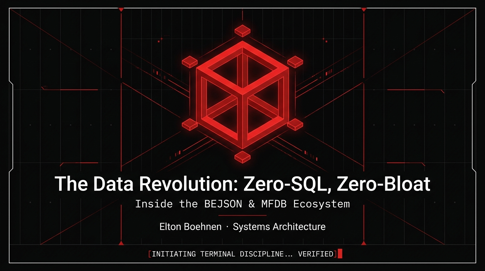
</div>

### Central Purpose: AI-Native Relational Databasing (`BEJSON` & `MFDB`)

Traditional relational database engines require background server daemons, binary wire protocols, ORM layers, and verbose SQL queries that burn valuable AI model context tokens and fail inside sandboxed mobile or edge environments. **Elton Boehnen's ecosystem is built around a singular primary mission: AI-Native Relational Databasing.**

By declaring schema fields (`Fields`) once at the top of a document and packing records into dense, positional 2D arrays (`Values`) linked across files by a central manifest (`104a.mfdb.bejson` / `105a.mfdb.bejson`), **BEJSON** (`BOEHNEN ELTON JSON`) and **MFDB** (`Multi File Database`) deliver:

- **Maximum Context Window Density**: Eliminating repeated JSON key strings per record reduces token footprint by **55%–70%**, allowing autonomous AI agents to ingest entire relational tables directly into context.
- **Zero-Daemon Portability**: Databases live directly on the filesystem as human-readable, Git-diffable files protected by two-tier re-entrant locks (`RLock` + `.lock`) and atomic sibling-tempfile renames (`os.fsync` + `os.replace`)—running identically on Linux workstations and Android Termux ARM64 devices.
- **Cryptographic & Relational Determinism**: Format `105` mints immutable column-0 **UUIDv4** record identities, enforces per-record **SHA-256** verification digests, and executes cross-file foreign-key cascades (`ON DELETE CASCADE`, `RESTRICT`, `SET NULL`) without a background database server.

<div align="center">
  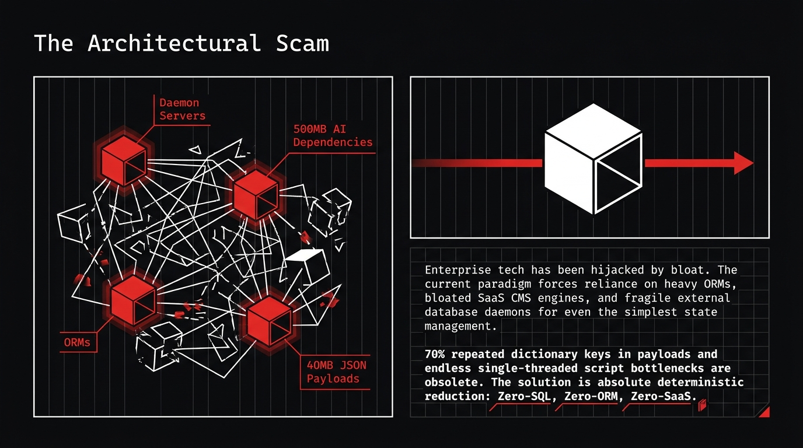
</div>

### Prerequisites & Environment Setup

- **Runtime**: Python `3.10+` (standard library core: `json`, `hashlib`, `uuid`, `urllib.request`, `tempfile`, `os`)
- **Optional Visual & Web Dependencies**: `flask` (for `BEJSON_CMS`, `NewAgent`, and `Project_Chunker` web consoles), `playwright` + `Pillow` + `ffmpeg` (for compiling deterministic SVG/GIF architecture diagrams)

- **Environment Baseline**: See [`ENV.example.txt`](ENV.example.txt) and [`env_template`](https://github.com/boehnenelton/env_template) for sanitized pointers.
- **Platform Path Resolution**: Priority ordered across Android internal (`/storage/emulated/0`), external SD, Termux, and desktop Linux.
- **Fail-Closed Validation**: Scripts validate `active_dev_id` (`ANDROID_TERMUX_PRIMARY` / `LINUX_WORKSTATION`) and verify paths before execution.
- **Protected Directories**: "only idx" mode enforces Index-Only cataloging; blocks recursive wipes, moves, or deletes on protected roots.

```bash
# Clone the profile architecture hub
git clone https://github.com/boehnenelton/boehnenelton.git && cd boehnenelton

# Clone flagship ecosystem platforms
git clone https://github.com/boehnenelton/BEJSON_CMS.git
git clone https://github.com/boehnenelton/NewAgent.git
git clone https://github.com/boehnenelton/CLI_AI.git
```

### Quick Start Usage & Asset Compilation

All animated diagrams and cubic visual anchors embedded in this document are compiled directly from validated BEJSON and MFDB-132 schemas located in `assets/` and `dev/`:

```bash
# 1. Compile the static PNG/WebP cubic banners from BEJSON geometry
python3 dev/generate_hub_banners.py

# 2. Compile the animated cubic hero showcase GIF from assets/cubic_schema.104a.bejson
python3 dev/build_bejson_animated_showcase.py

# 3. Compile the animated ecosystem pipeline diagram GIF
python3 dev/generate_animated_diagram.py

# 4. Copy the 15 architectural slides & compile the 3 contextual 3.5-second animations
python3 dev/generate_contextual_animations.py
```

<div align="center">
  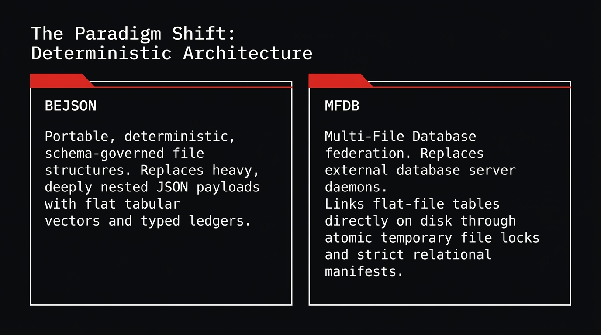
</div>

---

## Flagship Platform: `BEJSON_CMS` (File-Backed Content Management & Publishing Suite)

> **Flagship Repository:** [`github.com/boehnenelton/BEJSON_CMS`](https://github.com/boehnenelton/BEJSON_CMS)  
> **Core Stack:** Python 3.10+, Flask, BEJSON 104 / 105, MFDB (`site_master`), BKS-1 4-Part Writing Engine, Graphics 105 Asset Triad, Static HTML5 / CSS3 / RSS 2.0 Compiler

**[`BEJSON_CMS`](https://github.com/boehnenelton/BEJSON_CMS)** is the **#1 Flagship Application Platform** of the ecosystem. Purpose-built to prove that a file-backed relational database can power a full-featured enterprise publishing suite with zero SQL overhead, `BEJSON_CMS` unifies a **4-Service Admin & Publishing Topology, Visual Block-Page Editor, BKS-1 Multi-Stage Technical Blog Authoring Engine, Graphics 105 Hero Asset Compiler, and Static Site Generator** into one cohesive platform.

### 1. Animated `BEJSON_CMS` Architecture & Publishing Pipeline Diagram

The animated diagram below—packaged as a validated single-file **MFDB-132** diagram container ([`assets/bejson_cms_diagram.mfdb132.bejson`](assets/bejson_cms_diagram.mfdb132.bejson)) with `Board`, `Connector`, `Territory`, and `Shape_<id>` entities, verified for 40px node clearance, and rendered via `lib_bejson_Graphics_graphics_diagram_loader.py`—illustrates the live request routing, two-part page storage, BKS-1 blog generation, and static HTML compilation flow of **`BEJSON_CMS`**:

<div align="center">
  
</div>

*Diagram Artifacts: [`assets/bejson_cms_diagram.mfdb132.bejson`](assets/bejson_cms_diagram.mfdb132.bejson) · [`assets/bejson_cms_architecture_diagram.svg`](assets/bejson_cms_architecture_diagram.svg) · [`assets/bejson_cms_diagram_canvas.html`](assets/bejson_cms_diagram_canvas.html)*

---

### 2. Four-Service Flask Topology & `cms-manage.py` CLI Controller

`BEJSON_CMS` isolates administrative concerns into **four dedicated Flask web services** supervised by a unified 57-column CLI controller (`cms-manage.py`):

| Service Module | Default Port | Functional Role | Primary Routes & Actions |
| :--- | :---: | :--- | :--- |
| **`BEJSON_CMS_Admin.py`** | `:5000` | Central site administration console, navigation category editor, media asset registry inspector, and service health monitor. | `/`, `/pages`, `/categories`, `/media`, `/settings`, `/api/status`, `/api/services/control` |
| **`BEJSON_CMS_Publisher.py`** | `:5001` | Static site compiler, BKS-1 4-part technical blog runner, Graphics 105 hero asset binder, and RSS/Atom syndication builder. | `/publish`, `/jobs`, `/preview`, `/api/build/full`, `/api/build/incremental`, `/api/bks/run` |
| **`BEJSON_CMS_PageEditor.py`** | `:5002` | Authoritative visual block-page and HTML/Markdown editor (`v2.3+`) with live preview, template slot binding, and atomic two-part save. | `/editor/<page_uuid>`, `/api/page/load`, `/api/page/save`, `/api/blocks/schema`, `/api/preview/render` |
| **`BEJSON_CMS_ProfileManager.py`** | `:5003` | Author identity registry, session token rotation, role permissions, and AI authoring profile configuration. | `/profiles`, `/auth/login`, `/auth/rotate`, `/api/profile/save`, `/api/author/credits` |
| **`cms-manage.py`** | *CLI* | Process supervisor, MFDB schema validator, atomic backup packager, credential reset tool, and headless static site compiler. | `--start-all`, `--stop-all`, `--status`, `--publish`, `--backup`, `--reset-admin`, `--validate-db` |

<div align="center">
  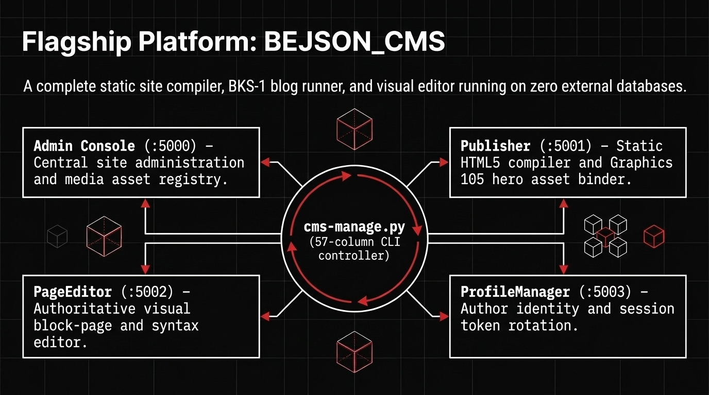
</div>

---

### 3. Two-Part Page Storage (`site_master` MFDB + `pages_db/`)

To guarantee sub-millisecond category index queries and navigation tree builds even across thousands of published articles, `BEJSON_CMS` implements a **Two-Part Page Storage Architecture** managed by `lib_bejson_CMS_cms_mfdb.py` and `lib_bejson_CMS_cms_core.py`:

1. **Relational Index Tier (`data/site_master.104a.mfdb` → `pagerecord.bejson` & `mediaasset.bejson`)**:
   - Stores compact tabular metadata rows for every page and media asset using BEJSON `104a`/`105a`.
   - Queried via a dictionary Field Map Cache on `page_record_slug_text`, `page_record_category_id`, `page_record_status_flag` (`draft`, `staged`, `published`, `archived`), and `page_record_published_timestamp`.
2. **Document Payload Tier (`data/pages_db/<page_uuid>.json`)**:
   - Stores the full block tree, long-form article HTML/Markdown sections, embedded interactive diagram payloads, and syntax-highlighted code blocks for each page.
   - Loaded into memory only when editing that specific page in `BEJSON_CMS_PageEditor.py` or compiling it during a publish job.

```text
BEJSON_CMS/
├── cms-manage.py                         # Unified 57-column CLI lifecycle & build controller
├── BEJSON_CMS_Admin.py                   # Port 5000: Site administration & MFDB console
├── BEJSON_CMS_Publisher.py               # Port 5001: BKS-1 pipeline & static HTML compiler
├── BEJSON_CMS_PageEditor.py              # Port 5002: Authoritative block & code page editor
├── BEJSON_CMS_ProfileManager.py          # Port 5003: Author profiles & authentication manager
├── config/
│   └── cms_config.104a.bejson            # Site-wide tokens, service ports & route settings
├── data/
│   ├── site_master.104a.mfdb             # Multi-File Database manifest linking CMS entities
│   ├── pagerecord.bejson                 # Tabular index of all site pages & metadata
│   ├── mediaasset.bejson                 # Indexed registry of SVG/PNG/WebP triads & diagrams
│   ├── category_registry.104a.bejson     # Navigation categories (rendered as 2-column wiki grid)
│   └── pages_db/                         # Per-page structured content payloads (<uuid>.json)
├── lib/
│   ├── lib_bejson_CMS_cms_config.py      # Configuration loader & environment pointer resolver
│   ├── lib_bejson_CMS_cms_core.py        # Page CRUD, slug sanitizer & template slot binder
│   ├── lib_bejson_CMS_cms_mfdb.py        # MFDB relational queries & two-tier lock manager
│   └── Writing/                          # BKS-1 4-part blog & manual pipeline modules
└── published_site/                       # Compiled static HTML5, CSS3, assets & feed.xml
```

<div align="center">
  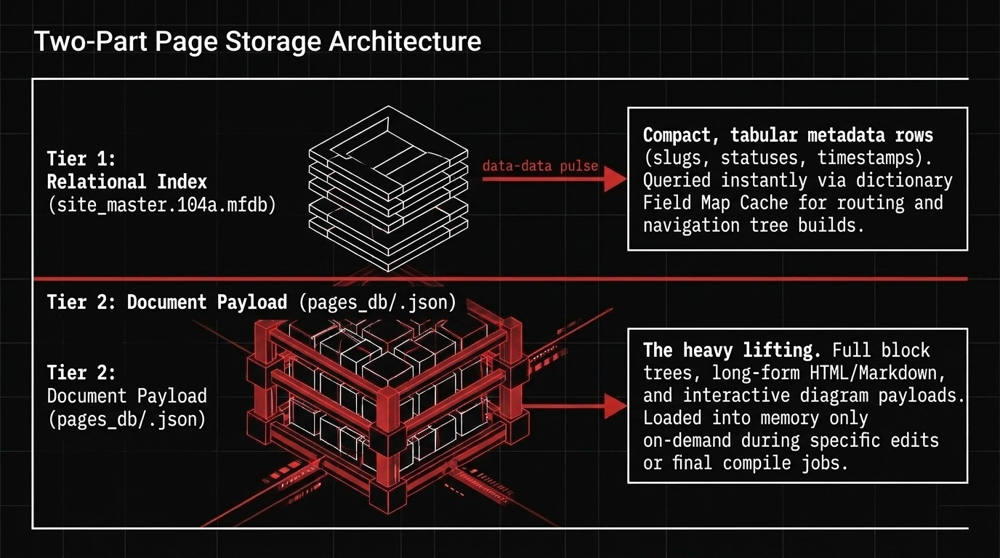
</div>

---

### 4. BKS-1 Four-Part Blog Execution & Graphics 105 Asset Triad

Technical articles in `BEJSON_CMS` are drafted, audited, and compiled through the **BKS-1 Writing Pipeline** (`lib_bejson_Writing_bks_*.py`) paired with the **Graphics 105 Visual Engine**:

- **Stage 1 (`bks_plan.py`)**: Formulates the 4-part article outline, target category classification, and code/diagram slot requirements.
- **Stage 2 (`bks_derive.py`)**: Drafts the 4 structural parts (Part I: Architectural Premise; Part II: Schema Specification; Part III: Implementation Walkthrough; Part IV: Verification & Benchmarks) via `CLI_AI` REST dispatch.
- **Stage 3 (`bks_render.py` & `Graphics 105`)**: Compiles a synchronized **Graphics 105 Asset Triad** (`1280x640` `.svg` vector source, `.png` social card, and `.webp` web banner) and binds them into a 16-sublane editorial HTML layout.
- **Stage 4 (`bks_gates.py`, `bks_store.py` & `bks_export.py`)**: Runs quality gates (link verification, asset presence, functional labeling check) and atomically writes both `pagerecord.bejson` and `pages_db/<uuid>.json`.

---

### 5. `BEJSON_CMS` Setup, Installation & CLI Usage

```bash
# 1. Check service status, MFDB manifest integrity, and indexed page count
python3 cms-manage.py --status

# 2. Start all 4 Flask services (Admin :5000, Publisher :5001, PageEditor :5002, ProfileManager :5003)
python3 cms-manage.py --start-all

# 3. Validate all MFDB entity tables and clear stale lock files
python3 cms-manage.py --validate-db

# 4. Compile the entire site into static HTML5/CSS3/RSS inside published_site/
python3 cms-manage.py --publish --full

# 5. Create a timestamped, SHA-256 verified backup archive of data/ and config/
python3 cms-manage.py --backup
```

---

### 6. Model-Template-View (MTV) Architecture & Static Publishing Pipeline

`BEJSON_CMS` implements an authoritative **Model-Template-View (MTV)** architecture powered by `libraries_105` (`lib_bejson_CMS_mtv_core.py`), delivering high-performance content rendering with cryptographic data integrity:

```text
+-------------------------------------------------------------------------+
|                  BEJSON_CMS MTV ARCHITECTURAL TOPOLOGY                  |
+-------------------+--------------------+--------------------------------+
|  MODEL (105a)     |  TEMPLATE (BECSS)  |  VIEW (Compiler & Static HTML) |
+-------------------+--------------------+--------------------------------+
|  - site_master    |  - 16-Sublane Grid |  - Incremental SSG Engine      |
|  - pagerecord     |  - Ry=32px Quantum |  - Atomic published_site/      |
|  - mediaasset     |  - Tri-Color Token |  - Full-Text Category Grids    |
|  - pages_db/ UUID |  - Zero-Filler DOM |  - RSS 2.0 & Atom XML Feeds    |
+-------------------+--------------------+--------------------------------+
```

- **The Model Layer (`BEJSON 105a` & `MFDB v1.40`)**:
  - All site state—pages, navigation categories, author profiles, and media registries—is governed by schema-validated BEJSON `105a` documents. Every row features an immutable column-0 **UUIDv4** identity, permanent **`field_uuid`** tags, and Two-Tier PathLocking (`RLock` + `.lock`).
- **The Template Layer (`BECSS Tri-Color Design`)**:
  - Editorial templates adhere strictly to the **Zero-Filler Skeleton Law** and **8-lane / 16-sublane Ry=32px vertical quantization**. Visual presentation is locked to the Tri-Color palette: Pitch Black (`#0A0A0C`), Crisp White (`#FFFFFF`), and Signature Vivid Red (`#DE2626`).
- **The View Layer & Incremental SSG Compiler**:
  - The static site generator (`BEJSON_CMS_Publisher.py`) performs fast streaming SHA-256 comparisons between source payloads (`data/pages_db/<uuid>.json`) and published artifacts in `published_site/`. Only mutated articles and updated category link grids are re-rendered, reducing site compilation times to sub-second speeds.
  - The compiled distribution is 100% self-contained static HTML5, CSS3, and SVG vector graphics ready for zero-daemon serverless hosting on **Cloudflare Pages** ([`boehnenelton2024.pages.dev`](https://boehnenelton2024.pages.dev)) and **GitHub Pages**.

---

## Canonical Standard Libraries (`libraries_104` & `libraries_105`)

Every platform in the ecosystem—including `BEJSON_CMS`, `CLI_AI`, `NewAgent`, and `Management_Tool`—is powered by two canonical, era-versioned development library suites (**Release_Version 300**):

- **`libraries_104` (Foundational Era — 19 Families, 90+ Modules)**: Governs Foundational BEJSON `104`, `104a` (schema-registered profiles), `104db` (multi-record streams), and **MFDB v1.31** relational databases.
- **`libraries_105` (Integrity Era — 7 Families, 26 Modules)**: Governs Integrity BEJSON `105`, `105a`, `105db`, and **MFDB v1.40**, adding mandatory **UUIDv4 primary identity minting** at column `0`, per-record **SHA-256 verification digests**, cross-table foreign key cascade enforcement, and the **Graphics 105 / Canvas 105** animation engines.

### 1. Animated `104` & `105` Library Architecture & Upgrade Pipeline Diagram

The animated diagram below illustrates how **Foundational Era (`libraries_104`)** and **Integrity Era (`libraries_105`)** families interconnect—showing the atomic upgrade bridge (`lib_bejson_Core_bejson_upgrade.py`) from `104` to `105` and the downstream consumption by `BEJSON_CMS` and `CLI_AI`:

<div align="center">
  
</div>

*Diagram Artifacts: [`assets/bejson_104_105_diagram.mfdb132.bejson`](assets/bejson_104_105_diagram.mfdb132.bejson) · [`assets/bejson_104_105_libraries_diagram.svg`](assets/bejson_104_105_libraries_diagram.svg) · [`assets/bejson_104_105_diagram_canvas.html`](assets/bejson_104_105_diagram_canvas.html)*

---

### 2. Era Comparison Matrix & 7-Pillar Evolution (`Foundational 104` vs. `Integrity 105`)

| Architectural Dimension | `libraries_104` (Foundational Era) | `libraries_105` (Integrity Era) |
| :--- | :--- | :--- |
| **Format Variants** | `104` (single table), `104a` (profile/schema-linked), `104db` (multi-type stream) | `105` (UUID base), `105a` (UUID + timeline/profile), `105db` (UUID integrity stream) |
| **MFDB Specification** | **MFDB v1.31 / v1.32** (`104a.mfdb.bejson` manifest + entity table bindings) | **MFDB v1.40** (`105a.mfdb.bejson` manifest + cross-entity UUID foreign-key cascades) |
| **Schema `Fields` Definitions** | `[{"name": "...", "type": "..."}]` (`string`, `integer`, `number`, `boolean`, `array`, `object`) | `[{"name": "...", "type": "...", "field_uuid": "<UUIDv4>"}]` (permanent field identity) |
| **Field Map Cache** | Dictionary cache (`{field_name: col_idx}`) mapping `Fields[i]` to `row[i]` | Self-maintaining `_FieldMap` with live layout fingerprints (`by_name_row`, `by_uuid`, `record_uuid` at `0`) |
| **Primary Record Identity** | Application-defined primary key column (`*_id` or `*_uuid` inside `Fields`) | System-minted **UUIDv4** primary identity at implicit `row[0]` (`bejson_core_add_record_105`) |
| **Cryptographic Verification** | Structural & primitive schema conformance (`E01`–`E89`) | Per-record **SHA-256 content digest** + strict integrity gates (`E90`–`E95`) |
| **Migration Path** | High-speed foundational persistence for logs, configs, and snapshots | In-place atomic upgrade from `104` via `lib_bejson_Core_bejson_upgrade.py` (`upgrade_to_105`) |

<div align="center">
  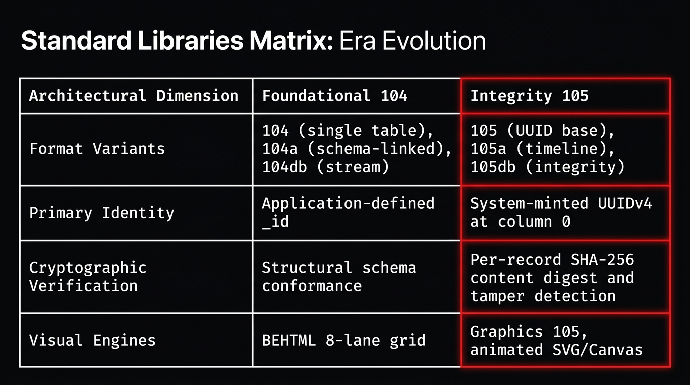
</div>

#### The 7-Pillar Architectural Evolution (`104` → `105`)

1. **Canonical Envelope & Permanent `field_uuid` Identity**:
   - Both eras share the strict top-level BEJSON envelope: `"Format": "BEJSON"`, `"Format_Version"`, `"Format_Creator": "Elton Boehnen"`, `"Records_Type": [...]`, `"Fields": [...]`, and `"Values": [[...]]`.
   - In Format `105`/`105a`, every entry in `"Fields"` carries a permanent `"field_uuid"` (`UUIDv4`), allowing columns to be renamed without breaking downstream queries or foreign-key references.
2. **Implicit Column-0 `record_uuid` Primary Key Minting**:
   - In Format `104`, `row[i]` corresponds directly to `Fields[i]`.
   - In Format `105`, `row[0]` is reserved for the immutable **UUIDv4 `record_uuid`** minted automatically by `bejson_core_add_record_105(doc, values)`, while `Fields[i]` maps to `row[i + 1]`.
3. **Self-Maintaining Field Map Cache with Live Layout Fingerprints**:
   - `bejson_core_get_field_map(doc)` compiles an in-memory `_FieldMap` storing `by_name_row`, `by_uuid`, and a live tuple fingerprint (`_bejson_fields_fingerprint(doc)`). If a schema is altered via `bejson_core_define_field` or `bejson_core_remove_field`, the cache automatically invalidates and rebuilds on the next read.
4. **Dual-Key Coordinate-Healing Cell Mutation (`bejson_core_write_cell`)**:
   - `bejson_core_write_cell(doc, row_index, col_index, value, record_uuid=..., field_uuid=...)` verifies that the target coordinate still holds the expected `record_uuid` and `field_uuid`. If concurrent inserts or schema shifts moved the row or column, `write_cell` heals the coordinate automatically via the UUID maps before writing.
5. **Cryptographic Content Hashing & Strict Integrity Gates (`E90`–`E95`)**:
   - `bejson_core_verify_105_integrity(doc)` and `bejson_validator_check_105_strict_integrity(doc)` validate UUIDv4 syntax, detect duplicate `field_uuid` or `record_uuid` collisions (`E90`–`E93`), and verify deterministic SHA-256 content digests (`_bejson_content_hash`).
6. **MFDB v1.31 vs. MFDB v1.40 Cross-Entity Cascades**:
   - While **MFDB v1.31** coordinates multi-file tables (`104a.mfdb.bejson`) and single-file `.mfdb132.bejson` packages, **MFDB v1.40** (`lib_bejson_Core_mfdb_core.py` in `libraries_105`) adds declarative cross-table foreign keys (`ON DELETE CASCADE`, `ON DELETE SET NULL`, `ON DELETE RESTRICT`) across partitioned files.
7. **Zero-Risk Atomic Upgrade Engine (`lib_bejson_Core_bejson_upgrade.py`)**:
   - `upgrade_to_105(path)` validates the source `104`/`104a`/`104db` document first, copies a verbatim rollback snapshot to `Backups/<filename>.104.bak`, mints `field_uuid` and column-0 `record_uuid` identities in memory, runs strict `105` validation, and swaps the upgraded file into place via atomic `os.replace`.

#### Side-by-Side Canonical Envelope Comparison (`104a` vs. `105a`)

```json
// Foundational Era: telemetry_nodes.104a.bejson (Fields[i] -> row[i])
{
  "Format": "BEJSON",
  "Format_Version": "104a",
  "Format_Creator": "Elton Boehnen",
  "Schema_Name": "telemetry_nodes",
  "Records_Type": ["TelemetryNode"],
  "Fields": [
    {"name": "node_id",    "type": "string"},
    {"name": "cpu_load",   "type": "number"},
    {"name": "is_healthy", "type": "boolean"}
  ],
  "Values": [
    ["node_alpha_01", 0.42, true]
  ]
}
```

```json
// Integrity Era: telemetry_nodes.105a.bejson (row[0] = record_uuid, Fields[i] -> row[i + 1])
{
  "Format": "BEJSON",
  "Format_Version": "105a",
  "Format_Creator": "Elton Boehnen",
  "Schema_Name": "telemetry_nodes",
  "Records_Type": ["TelemetryNode"],
  "Fields": [
    {"name": "node_id",    "type": "string",  "field_uuid": "9a1b2c3d-1111-4000-8000-000000000001"},
    {"name": "cpu_load",   "type": "number",  "field_uuid": "9a1b2c3d-1111-4000-8000-000000000002"},
    {"name": "is_healthy", "type": "boolean", "field_uuid": "9a1b2c3d-1111-4000-8000-000000000003"}
  ],
  "Values": [
    ["e4f5a6b7-0001-4000-8000-000000000001", "node_alpha_01", 0.42, true]
  ]
}
```

---

### 3. `libraries_104` Brief Module Inventory (Foundational Era — 19 Families)

All `libraries_104` Python modules follow the canonical 4-part naming convention `lib_bejson_<Family>_<module>.py`:

| # | Family (`libraries_104/Lib_PY/`) | Core Modules (`lib_bejson_<Family>_*.py`) | Concise Functional Summary |
| :-: | :--- | :--- | :--- |
| 1 | **`Core`** | `bejson_core`, `bejson_validator`, `mfdb_core`, `bejson_104db_parser`, `bejson_chunking`, `bejson_core_nesting`, `bejson_env`, `bejson_path_guard`, `bejson_state_management` | Foundational `104`/`104a`/`104db` CRUD, Field Map Cache builders, Two-Tier PathLocking (`RLock` + `.lock`), atomic `.tmp` writes, cell nesting (depth 16), and `definitions.json` resolution. |
| 2 | **`Core_Extension`** | `bejson_pagecache` | In-memory LRU table cache with automatic file `mtime` invalidation for high-frequency reads. |
| 3 | **`AI`** | `chat_interactions_engine`, `bejson_interactions`, `chat_key_rotator`, `gemini_standard_profiles`, `ai_call_logger`, `brain_memory`, `rest_providers` | Stdlib REST clients for Google Gemini Interactions API (`v1beta/interactions`), OpenAI, Anthropic, DeepSeek, and Ollama; 12-key affinity rotation; local context re-seeding; and 80k-token context bubble governance. |
| 4 | **`CMS`** | `cms_config`, `cms_core`, `cms_mfdb` | Configuration loader, two-part page CRUD (`pagerecord.bejson` + `pages_db/`), slug sanitization, and `site_master` MFDB driver for `BEJSON_CMS`. |
| 5 | **`Writing`** | `bks_plan`, `bks_derive`, `bks_render`, `bks_store`, `bks_export`, `bks_gates` | The **BKS-1** 4-part technical blog and manual authoring pipeline: planning, section derivation, HTML/BEHTML rendering, quality gates, and static export. |
| 6 | **`BEHTML`** | `behtml_core`, `behtml_layout`, `behtml_collision`, `behtml_validator`, `behtml_compiler` | Deterministic **8-lane / 16-sublane** spatial UI grid engine with **Ry=32px vertical quantization** and 18-field element validation. |
| 7 | **`BEHTML_IDE`** | `behtml_ide_server`, `behtml_ide_canvas`, `behtml_ide_inspector` | Visual browser canvas and coordinate inspector for authoring BEHTML layouts. |
| 8 | **`HTML`** | `html3_core`, `html3_components`, `html3_diagrams`, `html3_tables`, `html3_themes` | Tri-Color (`#000000`, `#FFFFFF`, `#DE2626`) HTML5 UI builders, responsive cards, overflow dock strips, and embeddable diagram tabs. |
| 9 | **`Diagrams`** | `diagrams_core`, `diagrams_validator`, `diagrams_ai` | Entity-based diagram modeler (`Board`, `Connector`, `Territory`), Manhattan router, 40px clearance validator, and `.mfdb132.bejson` packager. |
| 10 | **`Chunker`** | `mfdb_chunker_v5`, `mfdb_chunker_v6` | Collapses multi-file repositories and MFDB trees into portable single-file `.bejson` / `.mfdb132.bejson` containers. |
| 11 | **`Projects`** | `projects_tracker`, `projects_archive`, `projects_locks`, `projects_pipeline`, `projects_zip` | Governs solid integer package versions (`Name_Case-V#-PKG#`), `bejson_project.json` manifests, and release ZIP builds. |
| 12 | **`Bookmaker`** | `bookmaker_core`, `bookmaker_chapters`, `bookmaker_glossary`, `bookmaker_epub` | Multi-chapter technical book and documentation portal compiler with automated glossaries and drawer navigation. |
| 13 | **`Cognition`** | `cognition_patterns`, `cognition_nuance`, `cognition_synthesis` | Extracts conceptual archetypes, architectural tradeoffs, and nuance registries from engineering notes. |
| 14 | **`ExpCMS`** | `expcms_router`, `expcms_widgets`, `expcms_feeds` | Modular category feed routers, wiki-style 2-column category link grids, and editorial widget shelves. |
| 15 | **`Gaming`** | `gaming_state`, `gaming_grid`, `gaming_loop` | Turn-based state machines and 2D grid coordinate persistence stored in BEJSON `104a`. |
| 16 | **`Lists`** | `lists_core`, `lists_filter`, `lists_export` | Priority queues, reminder registries, and sorted tabular list operations. |
| 17 | **`MD`** | `md_parser`, `md_renderer`, `md_toc` | GitHub-Flavored Markdown AST parser, HTML renderer, and Table of Contents generator. |
| 18 | **`System`** | `system_jobs`, `system_hierarchy`, `system_logs`, `system_maintenance` | Standing maintenance job registries, 4-Tier directory hierarchy drift auditing (`.path.bejson`), and daily telemetry logs. |
| 19 | **`Utility`** | `utility_cli`, `utility_tui`, `utility_sanitization`, `utility_crypto` | 57-column portrait CLI formatters, ANSI arrow-key TUI menus, boundary string sanitization, and AES-GCM helpers. |

---

### 4. `libraries_105` Brief Module Inventory (Integrity Era — 7 Families)

`libraries_105` provides **26 Integrity Era modules** across **7 domain families**:

| # | Family (`libraries_105/Lib_PY/`) | Core Modules (`lib_bejson_<Family>_*.py`) | Concise Functional Summary |
| :-: | :--- | :--- | :--- |
| 1 | **`Core`** | `bejson_core` (`v3.6.0`), `bejson_validator`, `bejson_upgrade`, `mfdb_core` (`v1.40`) | Format `105`/`105a`/`105db` CRUD with column-0 **UUIDv4 minting**, per-record **SHA-256 digests**, `E90`–`E95` tamper validation, **MFDB v1.40** FK cascades, and atomic `104 → 105` migration. |
| 2 | **`Graphics`** | `graphics_core` (`v1.1.0`), `graphics_schemas`, `graphics_canvas_templates`, `graphics_diagram_loader`, `graphics_validator` | Compiles `105a` vector primitives, isometric cubes, and row-per-frame timelines into SVG, PNG, WebP, and animated GIF assets; bridges `Diagrams` models into animated canvases. |
| 3 | **`Canvas`** | `canvas_schemas`, `canvas_templates` | Spatial coordinate matrices and procedural pattern generators (Isometric Cube 128px, Circuit Grid 64px, Checkerboard 64px). |
| 4 | **`CMS`** | `mtv_core`, `mtv_scaffold`, `mtv_validator` | Model-Template-View (`MTV`) schema binding and content safety validators for `BEJSON_CMS` 105 stores. |
| 5 | **`Standards`** | `standards_core`, `standards_registry`, `standards_state`, `standards_export`, `standards_validator` | Machine-verifiable code standards registries, AST compliance rules, and audit report exporters. |
| 6 | **`Tax_Scaffolds`** | `tax_scaffolds_core`, `tax_scaffolds_scaffold`, `tax_scaffolds_validator` | Scaffolds and validates `<hierarchy>_<group>_<purpose>` column taxonomies and relational table templates. |
| 7 | **`Taxonomies`** | `taxonomies_core`, `taxonomies_registry`, `taxonomies_validator` | Central symbol, entity prefix, and category classification registries with collision detection. |

---

### 5. Deep Dive: Core, Graphics, Diagrams, Canvas, Taxonomies & CMS Families

```text
+-----------------------------------------------------------------------------------------+
|                              CANONICAL LIBRARY ECOSYSTEM                                |
+----------------------------+----------------------------+-------------------------------+
|  1. CORE FAMILY            |  2. GRAPHICS & CANVAS      |  3. DIAGRAMS FAMILY           |
|  - bejson_core (v3.6.0)    |  - graphics_core (v1.1.0)  |  - diagrams_core (v1.2.0)     |
|  - mfdb_core (v1.40)       |  - graphics_schemas        |  - diagrams_validator         |
|  - bejson_validator        |  - graphics_diagram_loader |  - diagrams_ai                |
|  - bejson_upgrade          |  - canvas_templates        |  - mfdb132_packaging          |
|  - bejson_core_nesting     |  - canvas_schemas          |  - board_connector_territory  |
|  - bejson_chunking         |  - blank_slate_stages      |  - manhattan_orthogonal_route |
+----------------------------+----------------------------+-------------------------------+
|  4. TAXONOMY & SCAFFOLDS   |  5. CMS & WRITING FAMILY   |  6. POLYGLOT CORE             |
|  - schema_taxonomies       |  - cms_core / cms_mfdb     |  - Lib_TS (TypeScript Core)   |
|  - tax_scaffolds_core      |  - mtv_core / mtv_scaffold |  - Lib_JS (Web Crypto Node)   |
|  - standards_registry      |  - bks_plan..bks_export    |  - Lib_SH (POSIX Shell CLI)   |
+----------------------------+----------------------------+-------------------------------+
```

#### Core Family (`lib_bejson_Core_*`)
- **`lib_bejson_Core_bejson_core.py` (v3.6.0)**:
  - Atomic file operations via `bejson_core_atomic_write` using sibling tempfile buffers, `os.fsync`, and `os.replace` rename guards.
  - Self-validating Field Map Cache with live document layout fingerprints (`_bejson_fields_fingerprint`).
  - Format 105 UUIDv4 primary identity minting per record (`bejson_core_add_record_105`).
  - Dual-key coordinate-healing cell writes (`bejson_core_write_cell`).
- **`lib_bejson_Core_mfdb_core.py` (v1.40)**:
  - Multi-File Database coordinator loading and verifying manifests (`104a.mfdb.bejson` and `105a.mfdb.bejson`).
  - Enforces cross-entity relational cascades (`ON DELETE CASCADE`, `ON DELETE SET NULL`, `ON DELETE RESTRICT`) and in-memory joins across partitioned files.
- **`lib_bejson_Core_bejson_validator.py` & `lib_bejson_Core_bejson_upgrade.py`**:
  - Deterministic structural conformance testing against error codes `E01`–`E95` and in-place atomic upgrades from Format `104` to Format `105`.

#### Graphics & Diagrams Families (`lib_bejson_Graphics_*` & `lib_bejson_Diagrams_*`)
- **`lib_bejson_Graphics_graphics_core.py` (v1.1.0)** & **`lib_bejson_Graphics_graphics_diagram_loader.py`**:
  - Native Playwright SVG capture engine, row-per-frame animation controller (`create_row_per_frame_animation_105a`), procedural 3D isometric cube generator (`create_isometric_cube_svg`), and interactive HTML5/SVG diagram renderer (`render_diagram_svg`).
- **`lib_bejson_Diagrams_diagrams_core.py` (v1.2.0)** & **`lib_bejson_Diagrams_diagrams_validator.py`**:
  - Canonical diagram entity definitions (`BOARD_BASE_FIELDS`, `CONNECTOR_BASE_FIELDS`, `TERRITORY_BASE_FIELDS`, `SHAPE_BASE_FIELDS`), pre-validation (`validatePlanSemantics`), 40px bounding-box clearance checks (`validateDiagram`), auto-remediation (`remediateDiagram`), and single-file `.mfdb132.bejson` packaging.

---

### 6. Secondary Central Theme: Core Polyglot Parity (`Lib_PY`, `Lib_TS`, `Lib_JS`, `Lib_SH`)

A foundational achievement of `libraries_104` and `libraries_105` (**Release_Version 300**) is **Core Polyglot Parity**: the exact same BEJSON `104`/`105` document envelope, Field Map Cache coordinate math, error code registry (`E01`–`E95`), and `MFDB` manifest contracts are implemented across **four independent runtime languages**:

| Runtime Suite | Target Environments | Architectural Idiom & Strengths | Core Modules (`Core/`) |
| :--- | :--- | :--- | :--- |
| **`Lib_PY` (Python 3.10+)** | Linux, macOS, Android Termux ARM64, Flask microservices, CLI/TUI daemons | **Authoritative Reference Implementation**: In-place atomic `.tmp` + `os.replace` writes, `ResilientPIDLock`, self-healing `_FieldMap`, and `upgrade_to_105`. | `lib_bejson_Core_bejson_core.py`, `bejson_validator.py`, `bejson_upgrade.py`, `mfdb_core.py`, `bejson_chunking.py` |
| **`Lib_TS` (TypeScript)** | Node.js, Bun, Deno, Browser SPAs, Cloudflare Workers | **Pure Functional Immutability**: Zero `fs` coupling; every mutator (`writeCell`, `addRecord105`, `upgradeTo105`) returns a new strongly-typed `BEJSONDocument<T>`. | `lib_bejson_Core_bejson_core.ts`, `bejson_core_105.ts`, `bejson_field_map.ts`, `bejson_types.ts`, `mfdb_core.ts` |
| **`Lib_JS` (JavaScript ES2022)** | Browser DOM canvases, Node.js CLI scripts, Playwright harnesses | **Native Web Crypto Integration**: Uses standard `crypto.subtle` for zero-dependency SHA-256 digests and AES-GCM chunk encryption. | `lib_bejson_Core_bejson_core.js`, `bejson_validator.js`, `mfdb_core.js`, `bejson_chunking.js`, `bejson_secure_zip.js` |
| **`Lib_SH` (POSIX Shell / Bash)** | Termux bootstrap hooks, cron pipelines, recovery shells | **Zero-Runtime CLI Portability**: Pure Bash + `jq`/`awk` pipeline (`set -o pipefail`) enforcing identical `E01`–`E95` exit codes and Field Map lookups. | `lib_bejson_Core_bejson_core.sh`, `bejson_validator.sh`, `mfdb_core.sh`, `bejson_chunking.sh`, `bejson_errors.sh` |

<div align="center">
  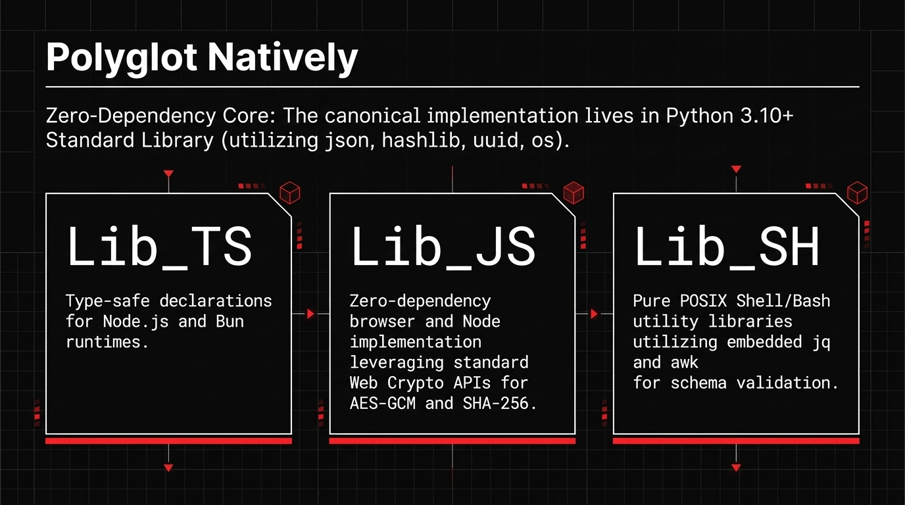
</div>

#### Side-by-Side Polyglot Parity Showcase (Field Map Cache & Cell Resolution)

Whether a BEJSON `105a` file is opened by a Python Flask service, a TypeScript edge worker, or a Bash maintenance hook, the column offset math (`row[0]` = `record_uuid`, `Fields[i]` = `row[i + 1]`) and validation rules are identical:

```python
# 1. Python 3.10+ (Lib_PY/Core/lib_bejson_Core_bejson_core.py)
from lib_bejson_Core_bejson_core import (
    bejson_core_load_file,
    bejson_core_get_field_map,
    bejson_core_write_cell,
    bejson_core_atomic_write,
)

doc = bejson_core_load_file("data/telemetry_nodes.105a.bejson")
field_map = bejson_core_get_field_map(doc)  # {"record_uuid": 0, "node_id": 1, "cpu_load": 2, "is_healthy": 3}

for row in doc["Values"]:
    if row[field_map["node_id"]] == "node_alpha_01":
        bejson_core_write_cell(doc, row_index=0, col_index="cpu_load", value=0.31, record_uuid=row[0])

bejson_core_atomic_write("data/telemetry_nodes.105a.bejson", doc)
```

```typescript
// 2. TypeScript (Lib_TS/Core/lib_bejson_Core_bejson_core_105.ts)
import { bejson_core_get_field_map_105 } from "./lib_bejson_Core_bejson_field_map";
import { bejson_core_write_cell_105 } from "./lib_bejson_Core_bejson_core_105";

const fieldMap = bejson_core_get_field_map_105(doc); // byName + byUuid with +1 offset for 105-series
const cpuColIdx = fieldMap.byName["cpu_load"];
const recordUuid = doc.Values[0][0] as string;

// Immutable return: produces a validated new BEJSONDocument without mutating input in place
const updatedDoc = bejson_core_write_cell_105(doc, 0, cpuColIdx, 0.31, recordUuid);
```

```bash
# 3. POSIX Shell / Bash (Lib_SH/Core/lib_bejson_Core_bejson_core.sh)
source /path/to/libraries_105/Lib_SH/Core/lib_bejson_Core_bejson_core.sh

DOC_JSON="$(cat data/telemetry_nodes.105a.bejson)"
bejson_validator_validate "$DOC_JSON" || exit $?

# Resolve column index by field name via Core shell helper
CPU_IDX="$(bejson_core_get_field_index "$DOC_JSON" "cpu_load")"
echo "Resolved cpu_load column index: $CPU_IDX"
```

---

## System Architecture & Data Flow Pipeline

<div align="center">
  
</div>

The ecosystem coordinates workloads across four deterministic execution stages:

1. **01 · Schemas (`BEJSON 104a / 105`)**: Immutable contract ledgers defining field types, column coordinates, UUIDv4 fingerprints, and cryptographic SHA-256 validation digests.
2. **02 · Resolution (`Field Map Cache`)**: Zero-allocation dictionary compilation that maps column names to integer tuple indices on initial load for constant-time slice reads.
3. **03 · Persistence (`MFDB Multi-File`)**: Relational database federation linking multiple flat-file tables through atomic rename locks without an external database daemon.
4. **04 · Subsystems (`Execution Platforms`)**: Clean dispatch layer routing workloads into **`BEJSON_CMS`**, **`CLI_AI`**, **`NewAgent`**, **`Management_Tool`**, and **`Reminder_Tool`**.

<div align="center">
  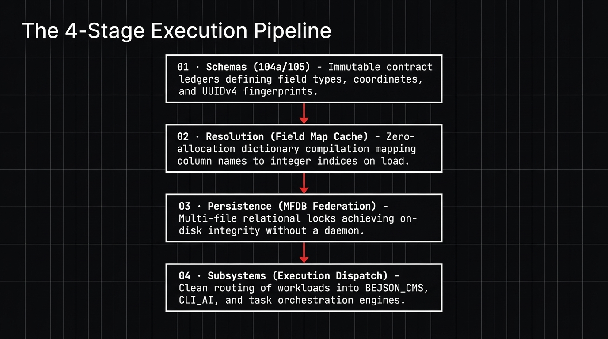
</div>

---

## BEJSON Schema-Driven Graphics Engine

Visual assets, architecture diagrams, and cubic branding anchors across this repository are compiled directly from structured BEJSON tabular schemas.

### 1. The Tabular Schema Specification (`cubic_schema.104a.bejson`)

Every vertex of the 3D isometric cube, the floating top diamond cap, the focal red divider, and the stage boundaries in [`assets/boehnenelton_cubic_engine.gif`](assets/boehnenelton_cubic_engine.gif) are stored as rows in [`assets/cubic_schema.104a.bejson`](assets/cubic_schema.104a.bejson):

```json
{
  "Format": "BEJSON",
  "Format_Version": "104a",
  "Format_Creator": "Elton Boehnen",
  "Schema_Name": "cubic_graphic_primitives",
  "Schema_Version": "1.0.0",
  "Description": "BEJSON 104a tabular vector graphic schema defining the canonical 3D isometric open branding cube and stage coordinates.",
  "Records_Type": ["CubicGraphicPrimitive"],
  "Fields": [
    {"name": "element_id",       "type": "string"},
    {"name": "primitive_type",   "type": "string"},
    {"name": "points_or_coords", "type": "string"},
    {"name": "fill_color",       "type": "string"},
    {"name": "stroke_color",     "type": "string"},
    {"name": "stroke_width",     "type": "number"},
    {"name": "animation_mode",   "type": "string"},
    {"name": "semantic_label",   "type": "string"}
  ],
  "Values": [
    ["elem_01_substrate",    "rect",    "0,0,1280,640",              "#0A0A0C", "none",    0.0, "static",         "Canvas Obsidian Substrate"],
    ["elem_02_frame",        "rect",    "48,48,1184,544",            "none",    "#1A1A22", 1.5, "static",         "Structural Inset Boundary Frame"],
    ["elem_03_notch",        "rect",    "48,270,4,100",              "#DE2626", "none",    0.0, "static",         "Left Boundary Accent Notch"],
    ["elem_04_divider",      "line",    "364,256,364,404",           "none",    "#DE2626", 3.0, "pulse_alpha",    "Primary Red Focal Divider"],
    ["elem_05_floating_cap", "polygon", "0,-48,56,-18,0,12,-56,-18", "#FFFFFF", "#FFFFFF", 1.5, "harmonic_float", "104a Hovering Diamond Cap"],
    ["elem_06_left_facet",   "polygon", "-56,-18,0,12,0,72,-56,42",  "#181820", "#FFFFFF", 1.5, "static",         "Left Obsidian Shading Facet"],
    ["elem_07_right_facet",  "polygon", "0,12,56,-18,56,42,0,72",    "#DE2626", "#FFFFFF", 1.5, "static",         "Right Signature Red Facet"]
  ]
}
```

### 2. Field Map Cache Resolution

To prevent fragile positional indexing (`row[3]`) or repeated linear scans across animation frames, the renderer builds a dictionary Field Map Cache upon loading the schema:

```python
# Build Field Map Cache via lib_bejson_Core_bejson_core
from lib_bejson_Core_bejson_core import bejson_core_get_field_map

field_map = bejson_core_get_field_map(bejson_doc)

# Direct named column addressability inside hot render loops
col_type   = field_map["primitive_type"]
col_coords = field_map["points_or_coords"]
col_fill   = field_map["fill_color"]
col_stroke = field_map["stroke_color"]
col_width  = field_map["stroke_width"]
col_anim   = field_map["animation_mode"]
```

<div align="center">
  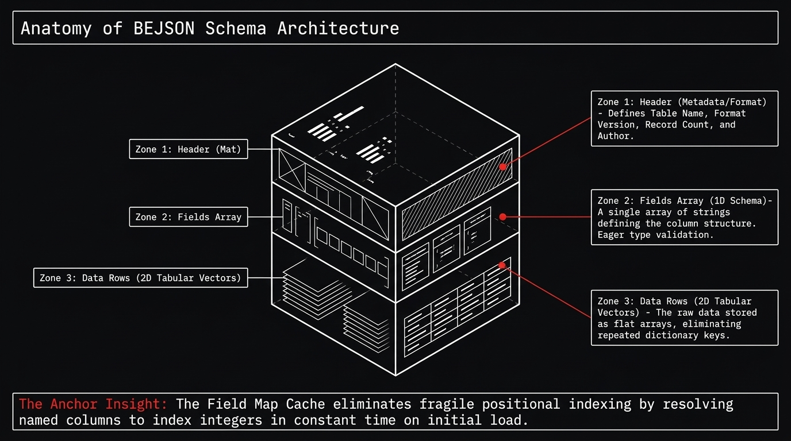
</div>

### 3. Deterministic Vector Compilation Pipeline

The renderer iterates rows via the Field Map Cache, computes harmonic vertical offsets for `harmonic_float` primitives, and emits standalone SVG markup:

```python
def compile_bejson_to_svg(bejson_doc: dict, time_sec: float = 0.0) -> str:
    """Compiles BEJSON 104a tabular graphic rows into deterministic SVG markup."""
    field_map = bejson_core_get_field_map(bejson_doc)
    rendered_elements = []

    for row in bejson_doc["Values"]:
        p_type = row[field_map["primitive_type"]]
        coords = row[field_map["points_or_coords"]]
        fill   = row[field_map["fill_color"]]
        stroke = row[field_map["stroke_color"]]
        width  = row[field_map["stroke_width"]]
        anim   = row[field_map["animation_mode"]]

        if anim == "harmonic_float":
            y_offset = -22.0 * math.sin(time_sec * 2.0 * math.pi)
            rendered_elements.append(
                f'<g transform="translate(0, {y_offset:.2f})">'
                f'<polygon points="{coords}" fill="{fill}" stroke="{stroke}" stroke-width="{width}"/>'
                f'</g>'
            )
        elif p_type == "polygon":
            rendered_elements.append(
                f'<polygon points="{coords}" fill="{fill}" stroke="{stroke}" stroke-width="{width}"/>'
            )
        elif p_type == "rect":
            x_pos, y_pos, width_px, height_px = coords.split(",")
            rendered_elements.append(
                f'<rect x="{x_pos}" y="{y_pos}" width="{width_px}" height="{height_px}" fill="{fill}" stroke="{stroke}" stroke-width="{width}"/>'
            )
        elif p_type == "line":
            x1_pos, y1_pos, x2_pos, y2_pos = coords.split(",")
            rendered_elements.append(
                f'<line x1="{x1_pos}" y1="{y1_pos}" x2="{x2_pos}" y2="{y2_pos}" stroke="{stroke}" stroke-width="{width}"/>'
            )

    return f'<svg width="1280" height="640">{"".join(rendered_elements)}</svg>'
```

---

## Authentic Schema Specifications & Data Models

### 1. Diagram Schema Architecture (`104a.mfdb.bejson` & `MFDB-132` Specification)

A BEJSON architecture diagram is modeled as an MFDB relational database comprising three core entity tables (`Board`, `Connector`, `Territory`) coordinated by a master manifest (`libraries_104/Lib_PY/Diagrams/lib_bejson_Diagrams_diagrams_core.py`):

#### Master Manifest (`104a.mfdb.bejson`)
```json
{
  "Format": "BEJSON",
  "Format_Version": "104a",
  "Format_Creator": "Elton Boehnen",
  "MFDB_Version": "1.32",
  "Network_Role": "Master",
  "DB_Name": "system_architecture_diagram",
  "DB_Description": "MFDB diagram database coordinating Board, Connector, and Territory entities.",
  "Schema_Version": "1.0.0",
  "Author": "Elton Boehnen",
  "Created_At": "2026-11-09T11:25:00Z",
  "Records_Type": ["mfdb"],
  "Fields": [
    {"name": "entity_name",    "type": "string"},
    {"name": "file_path",      "type": "string"},
    {"name": "description",    "type": "string"},
    {"name": "record_count",   "type": "integer"},
    {"name": "schema_version", "type": "string"},
    {"name": "primary_key",    "type": "string"}
  ],
  "Values": [
    ["Board",     "data/board.bejson",     "Diagram board shapes registry", 4, "1.0", "shape_id"],
    ["Connector", "data/connector.bejson", "Diagram connectors",            3, "1.0", "conn_id"],
    ["Territory", "data/territory.bejson", "Diagram territories",           1, "1.0", "terr_id"]
  ]
}
```

<div align="center">
  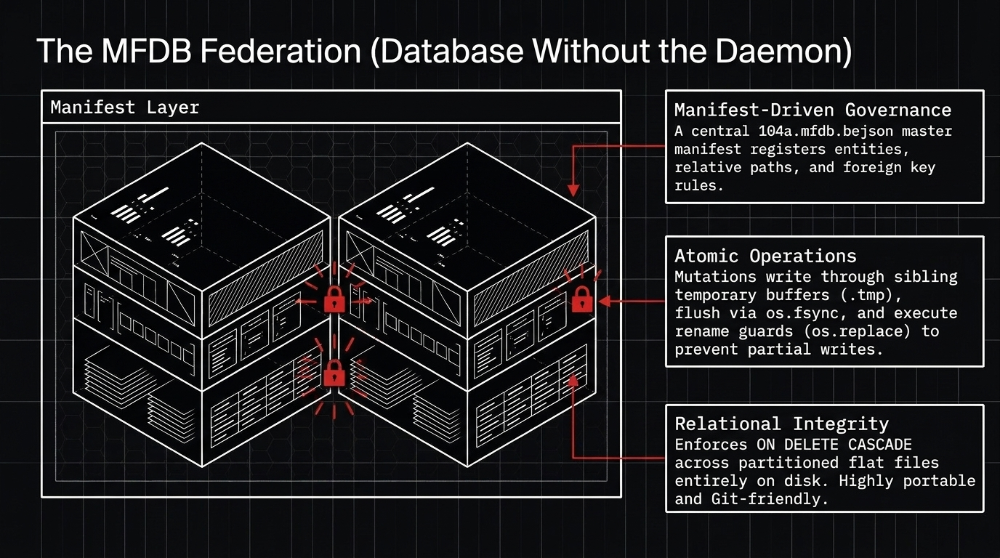
</div>

#### Board Entity Schema (`BOARD_BASE_FIELDS` in `data/board.bejson`)
```json
{
  "Format": "BEJSON",
  "Format_Version": "104",
  "Format_Creator": "Elton Boehnen",
  "Parent_Hierarchy": "../104a.mfdb.bejson",
  "Records_Type": ["Board"],
  "Fields": [
    {"name": "shape_id",          "type": "string"},
    {"name": "shape_entity_name", "type": "string"},
    {"name": "shape_cx",          "type": "number"},
    {"name": "shape_cy",          "type": "number"},
    {"name": "shape_size_class",  "type": "string"},
    {"name": "shape_kind",        "type": "string"},
    {"name": "shape_parent_fk",   "type": "string"},
    {"name": "shape_collapsed",   "type": "boolean"}
  ],
  "Values": [
    ["shape_01", "Shape_shape_01", 150, 270, "medium", "rect", null, false],
    ["shape_02", "Shape_shape_02", 370, 270, "medium", "rect", null, false],
    ["shape_03", "Shape_shape_03", 590, 270, "medium", "rect", null, false],
    ["shape_04", "Shape_shape_04", 810, 270, "medium", "rect", null, false]
  ]
}
```

#### Connector Entity Schema (`CONNECTOR_BASE_FIELDS` in `data/connector.bejson`)
```json
{
  "Format": "BEJSON",
  "Format_Version": "104",
  "Format_Creator": "Elton Boehnen",
  "Parent_Hierarchy": "../104a.mfdb.bejson",
  "Records_Type": ["Connector"],
  "Fields": [
    {"name": "conn_id",      "type": "string"},
    {"name": "conn_from_fk", "type": "string"},
    {"name": "conn_to_fk",   "type": "string"},
    {"name": "conn_flow",    "type": "string"}
  ],
  "Values": [
    ["conn_01_02", "shape_01", "shape_02", "forward"],
    ["conn_02_03", "shape_02", "shape_03", "forward"],
    ["conn_03_04", "shape_03", "shape_04", "forward"]
  ]
}
```

#### Single-File Portable MFDB-132 Package (`.mfdb132.bejson`)

Through `diagrams_core_create_mfdb132_package_from_model()`, the entire multi-file diagram database is collapsed into a single, portable, byte-for-byte verifiable `.mfdb132.bejson` document with embedded SHA-256 `File_Hash` digests:

```json
{
  "Format": "BEJSON",
  "Format_Version": "104a",
  "Format_Creator": "Elton Boehnen",
  "Schema_Name": "MFDB-132",
  "Schema_Version": "1.3.2",
  "Schema_Description": "MFDB 1.32 single-file diagram package.",
  "Chunk_Date": "2026-11-09T11:25:00.000000Z",
  "Session_Is_Mounted": false,
  "Mount_Path": "",
  "Package_Version": "1",
  "MFDB_Version": "1.32",
  "DB_Name": "bejson_104_105_libraries_arch",
  "Package_Format": "MFDB-Chunked-104a",
  "Diagram_Schema": "BEJSON-Diagram-1",
  "Records_Type": ["MFDB-132"],
  "Fields": [
    {"name": "File_Name",      "type": "string"},
    {"name": "File_Extension", "type": "string"},
    {"name": "File_Content",   "type": "string"},
    {"name": "File_Version",   "type": "string"},
    {"name": "File_Hash",      "type": "string"},
    {"name": "Relative_Path",  "type": "string"},
    {"name": "Is_Compressed",  "type": "boolean"},
    {"name": "Is_Encrypted",   "type": "boolean"}
  ],
  "Values": [
    ["104a.mfdb.bejson", ".bejson", "{\"Format\":\"BEJSON\"...}", "1.32", "a6e9...41c", "104a.mfdb.bejson", false, false],
    ["board.bejson",     ".bejson", "{\"Format\":\"BEJSON\"...}", "1.0",  "bf31...98d", "data/board.bejson", false, false],
    ["connector.bejson", ".bejson", "{\"Format\":\"BEJSON\"...}", "1.0",  "8c24...3a1", "data/connector.bejson", false, false],
    ["territory.bejson", ".bejson", "{\"Format\":\"BEJSON\"...}", "1.0",  "7d02...11e", "data/territory.bejson", false, false]
  ]
}
```

### 2. Animation Schema Architecture (Row-Per-Frame 105a Specification)

In `lib_bejson_Graphics_graphics_schemas.py`, a multi-frame animation sequence is declared as an Integrity Era `105a` table where every row represents a discrete rendering frame with an automatic column-0 `record_uuid` and SHA-256 verification digest:

```json
{
  "Format": "BEJSON",
  "Format_Version": "105a",
  "Format_Creator": "Elton Boehnen",
  "Schema_Name": "pulse_cube_animation",
  "Records_Type": ["GraphicRowFrame"],
  "Fields": [
    {"name": "frame_index",      "type": "integer", "field_uuid": "9b2c3d4e-2222-4000-8000-000000000001"},
    {"name": "timestamp_sec",    "type": "number",  "field_uuid": "9b2c3d4e-2222-4000-8000-000000000002"},
    {"name": "seek_progress",    "type": "number",  "field_uuid": "9b2c3d4e-2222-4000-8000-000000000003"},
    {"name": "fps",              "type": "integer", "field_uuid": "9b2c3d4e-2222-4000-8000-000000000004"},
    {"name": "frame_filename",   "type": "string",  "field_uuid": "9b2c3d4e-2222-4000-8000-000000000005"},
    {"name": "svg_markup",       "type": "string",  "field_uuid": "9b2c3d4e-2222-4000-8000-000000000006"},
    {"name": "frame_data_json",  "type": "string",  "field_uuid": "9b2c3d4e-2222-4000-8000-000000000007"},
    {"name": "is_rendered",      "type": "boolean", "field_uuid": "9b2c3d4e-2222-4000-8000-000000000008"},
    {"name": "checksum_sha256",  "type": "string",  "field_uuid": "9b2c3d4e-2222-4000-8000-000000000009"}
  ],
  "Values": [
    [
      "a1b2c3d4-0000-4000-8000-000000000001",
      0,
      0.000,
      0.000,
      12,
      "frame_0000.png",
      "<svg>...</svg>",
      "{\"y_float\": 0.0, \"pulse\": 1.0}",
      true,
      "e3b0c44298fc1c149afbf4c8996fb92427ae41e4649b934ca495991b7852b855"
    ],
    [
      "a1b2c3d4-0000-4000-8000-000000000002",
      1,
      0.083,
      0.041,
      12,
      "frame_0001.png",
      "<svg>...</svg>",
      "{\"y_float\": -5.5, \"pulse\": 0.95}",
      true,
      "5feceb66ffc86f38d952786c6d696c79c2dbc239dd4e91b46729d73a27fb57e9"
    ]
  ]
}
```

<div align="center">
  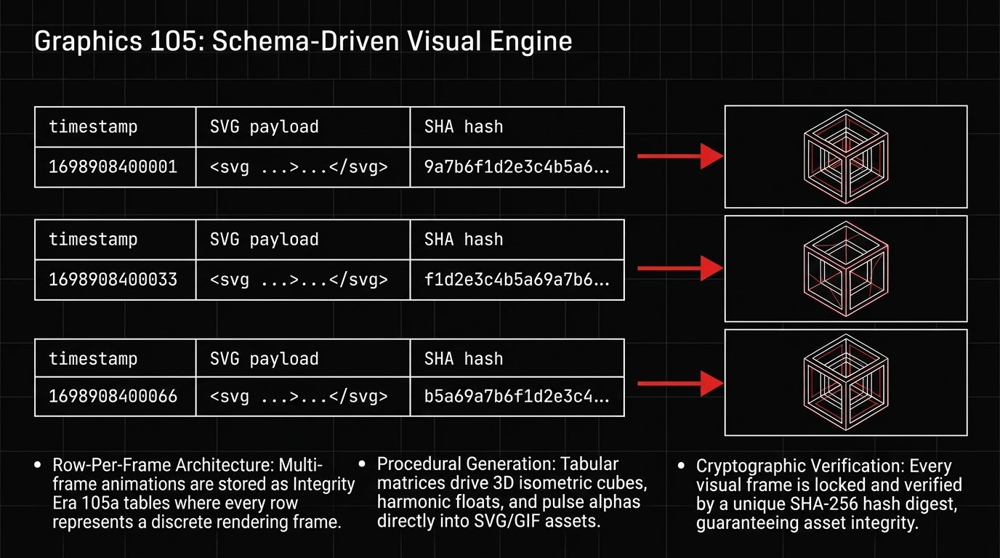
</div>

### 3. Canvas Config Schema Specification

The `GRAPHIC_CANVAS_CONFIG_FIELDS` contract standardizes stage geometry across all Graphics 105 tools:

| Field Name | Type | Permanent Field UUID | Functional Purpose |
|---|---|---|---|
| `canvas_id` | `string` | `9a1b2c3d-1111-4000-8000-000000000001` | Unique stage instance identifier |
| `template_name` | `string` | `9a1b2c3d-1111-4000-8000-000000000002` | Reference to blank-slate HTML template |
| `stage_selector`| `string` | `9a1b2c3d-1111-4000-8000-000000000003` | CSS target DOM selector (`#stage-root`) |
| `width_px` | `integer` | `9a1b2c3d-1111-4000-8000-000000000004` | Canvas horizontal pixel width |
| `height_px` | `integer` | `9a1b2c3d-1111-4000-8000-000000000005` | Canvas vertical pixel height |
| `aspect_ratio` | `string` | `9a1b2c3d-1111-4000-8000-000000000006` | Ratio invariant (`1:1`, `16:9`, `2:1`) |
| `bg_theme` | `string` | `9a1b2c3d-1111-4000-8000-000000000007` | Canvas theme (`dark_obsidian`, `light_white`) |
| `accent_color` | `string` | `9a1b2c3d-1111-4000-8000-000000000008` | Primary accent color (`#DE2626`) |
| `device_scale` | `integer` | `9a1b2c3d-1111-4000-8000-000000000009` | Device pixel ratio (`1` for 1x, `2` for Retina) |
| `output_dir` | `string` | `9a1b2c3d-1111-4000-8000-000000000010` | Destination frame export folder |
| `text_overlays_json`|`string`| `9a1b2c3d-1111-4000-8000-000000000011`| Serialized list of text overlays |
| `remove_frame_source`|`boolean`|`9a1b2c3d-1111-4000-8000-000000000012`| Auto-cleanup temporary SVG frames after render |

---

## Practical Code Patterns & API Usage

### Pattern 1: Initializing a 105 Store with UUIDv4 Identity

```python
from lib_bejson_Core_bejson_core import (
    bejson_core_create_document,
    bejson_core_define_field,
    bejson_core_add_record_105,
    bejson_core_atomic_write,
)

# 1. Initialize Format 105 document
telemetry_doc = bejson_core_create_document(
    table_name="telemetry_metrics",
    format_version="105",
    author="Elton Boehnen"
)

# 2. Define schema fields with eager type validation
bejson_core_define_field(telemetry_doc, field_name="metric_name", field_type="string")
bejson_core_define_field(telemetry_doc, field_name="metric_value", field_type="number")
bejson_core_define_field(telemetry_doc, field_name="is_active", field_type="boolean")

# 3. Add record: automatically mints UUIDv4 at column 0
minted_record_uuid = bejson_core_add_record_105(
    telemetry_doc,
    values=["cpu_utilization_ratio", 0.42, True]
)

# 4. Persist with atomic tempfile + rename guarantee
bejson_core_atomic_write(telemetry_doc, "data/telemetry_metrics.105.bejson")
```

### Pattern 2: Querying & Mutating via Field Map Cache

```python
import logging
from lib_bejson_Core_bejson_core import (
    bejson_core_load_file,
    bejson_core_get_field_map,
    bejson_core_write_cell,
    bejson_core_atomic_write,
)

# Load document: Field Map Cache is warmed on ingestion
telemetry_doc = bejson_core_load_file("data/telemetry_metrics.105.bejson")
field_map = bejson_core_get_field_map(telemetry_doc)

# Named column resolution across records
metric_value_col_idx = field_map["metric_value"]
for record_row in telemetry_doc["Values"]:
    if record_row[metric_value_col_idx] > 0.80:
        logging.info("High utilization metric: %s", record_row[metric_value_col_idx])

# Dual-key cell mutation: self-healing against column coordinate shifts
bejson_core_write_cell(
    telemetry_doc,
    row_idx=0,
    field_identifier="metric_value",
    new_value=0.55
)
bejson_core_atomic_write(telemetry_doc, "data/telemetry_metrics.105.bejson")
```

### Pattern 3: Multi-File Database (MFDB) Federation

```python
from lib_bejson_Core_mfdb_core import (
    mfdb_core_create_database,
    mfdb_core_register_entity,
    mfdb_core_query_relation,
)

# Initialize master manifest (104a.mfdb.bejson)
mfdb_core_create_database(
    db_name="cms_site_master",
    author="Elton Boehnen",
    db_root="data/mfdb"
)

# Register relational entity tables with foreign key cascades
mfdb_core_register_entity(
    db_root="data/mfdb",
    entity_name="Categories",
    table_filename="Categories.104.bejson",
    primary_key="category_id"
)
mfdb_core_register_entity(
    db_root="data/mfdb",
    entity_name="Pages",
    table_filename="Pages.104.bejson",
    primary_key="page_id",
    foreign_keys=[{"field": "category_fk", "target_entity": "Categories", "on_delete": "CASCADE"}]
)
```

### Pattern 4: Compiling Multi-Frame Animations via Graphics Core

```python
from lib_bejson_Graphics_graphics_core import (
    create_row_per_frame_animation_105a,
    create_isometric_cube_svg,
    render_animation_to_gif,
)

# 1. Initialize 24-frame animation controller
animation_doc = create_row_per_frame_animation_105a(
    animation_name="cube_rotation",
    duration_sec=2.0,
    fps=12,
    width_px=960,
    height_px=540
)

# 2. Populate frames with procedural vector geometry
for frame_index in range(24):
    seek_progress = frame_index / 24.0
    frame_svg = create_isometric_cube_svg(
        viewbox_size=540,
        cube_style="104a_floating",
        pulse_intensity=1.0 + (0.3 * seek_progress)
    )
    animation_doc["Values"].append([
        f"frame_{frame_index:04d}",
        frame_index,
        seek_progress * 2.0,
        seek_progress,
        12,
        f"frame_{frame_index:04d}.png",
        frame_svg,
        "{}",
        False,
        ""
    ])

# 3. Render directly to animated GIF using Playwright and Pillow
render_animation_to_gif(animation_doc, output_path="assets/cube_rotation.gif")
```

### Pattern 5: Diagram Serialization & MFDB-132 Packaging

```python
from pathlib import Path
from lib_bejson_Diagrams_diagrams_core import (
    diagrams_core_create_mfdb132_package_from_model,
    diagrams_core_extract_diagram_model_from_mfdb132,
)

diagram_model = {
    "diagramId": "diag_cms_01",
    "name": "CMS Service Topology",
    "shapes": [
        {"id": "n1", "label": "BEJSON_CMS_Admin", "cx": 200, "cy": 150, "kind": "rect", "color": "#181820"},
        {"id": "n2", "label": "BEJSON_CMS_PageEditor", "cx": 500, "cy": 150, "kind": "rect", "color": "#DE2626"}
    ],
    "connectors": [
        {"id": "c1", "from": "n1", "to": "n2", "flow": "forward"}
    ],
    "territories": []
}

# Pack entire diagram into a single-file portable MFDB-132 container
package_bytes = diagrams_core_create_mfdb132_package_from_model(diagram_model)
Path("cms_service_topology.mfdb132.bejson").write_bytes(package_bytes)
```

---

## Core Architectural Pillars

### BEJSON 104a & 105 Format Matrix

```text
+-------------------------------------------------------------------------+
| FOUNDATIONAL ERA (Format 104 / 104a / 104db)                           |
| - Header metadata + 1D 'Fields' schema array + 2D tabular 'Data' rows   |
| - Dictionary Field Map Cache for named column resolution                |
| - Format 104: Core single-table structured file                         |
| - Format 104a: Dynamic schema registry integration                      |
| - Format 104db: Relational multi-table entity bindings                  |
+-------------------------------------------------------------------------+
| INTEGRITY ERA (Format 105 / 105a / 105db)                               |
| - UUIDv4 primary identity minting per record at column 0                |
| - Cryptographic SHA-256 record verification digests                     |
| - Cross-entity relational cascades and foreign-key integrity             |
+-------------------------------------------------------------------------+
```

### Multi-File Database (MFDB)

MFDB federates multiple independent tabular entity files into a relational database stored directly on disk:
- **Manifest-Driven**: Master manifest documents (`104a.mfdb.bejson` and `105a.mfdb.bejson`) register entities, schemas, primary keys, and relative table paths.
- **Atomic Operations**: Mutations write through sibling temporary files, flush via `os.fsync`, and execute atomic `os.replace` renames to prevent partial writes.
- **Git-Friendly Portability**: Every database consists of human-readable JSON tables that can be inspected, diffed, backed up, or packed into a single `.mfdb132.bejson` container.

### 57-Column Portrait CLI Discipline

Every command-line tool in the ecosystem enforces a strict **57-column maximum line width** engineered for mobile touchscreens, Android Termux portrait terminals, and vertical split panes:

```text
=========================================================
 BEJSON_CMS LIFECYCLE CONTROLLER           v2.4 · PKG100
=========================================================
 [SERVICE]                 [PORT]   [PID]    [STATUS]
 --------------------------------------------------------
 BEJSON_CMS_Admin           5000     14820    ONLINE
 BEJSON_CMS_Publisher       5001     14824    ONLINE
 BEJSON_CMS_PageEditor      5002     14829    ONLINE
 BEJSON_CMS_ProfileManager  5003     14833    ONLINE
 --------------------------------------------------------
 MFDB Manifest : site_master.104a.mfdb       (VERIFIED)
 Pages Indexed : 142 records                 (0 LOCKS)
 Media Triads  : 88 SVG/PNG/WebP sets        (SYNCED)
=========================================================
 [1] Publish Site  [2] Backup DB  [3] Logs  [Q] Quit
=========================================================
```

### Tri-Color Visual Palette & Header Design Law

All web interfaces, static publications, SVG diagrams, and terminal outputs enforce strict visual invariants:
- **Pitch Black (`#0A0A0C` / `#000000`)**: Primary high-contrast dark canvas substrate.
- **Pure White (`#FFFFFF`)**: High-legibility typography and structural borders.
- **Signature Vivid Red (`#DE2626`)**: Directional dividers, active highlights, data-flow pulses, and cubic accents.
- **Header Design Law**: Web headers contain at most `[Hamburger Drawer Button] [App Title (<= 3 Words)] [Settings Overlay Cog]`, with secondary utilities placed on a horizontal overflow dock strip immediately below the header.

<div align="center">
  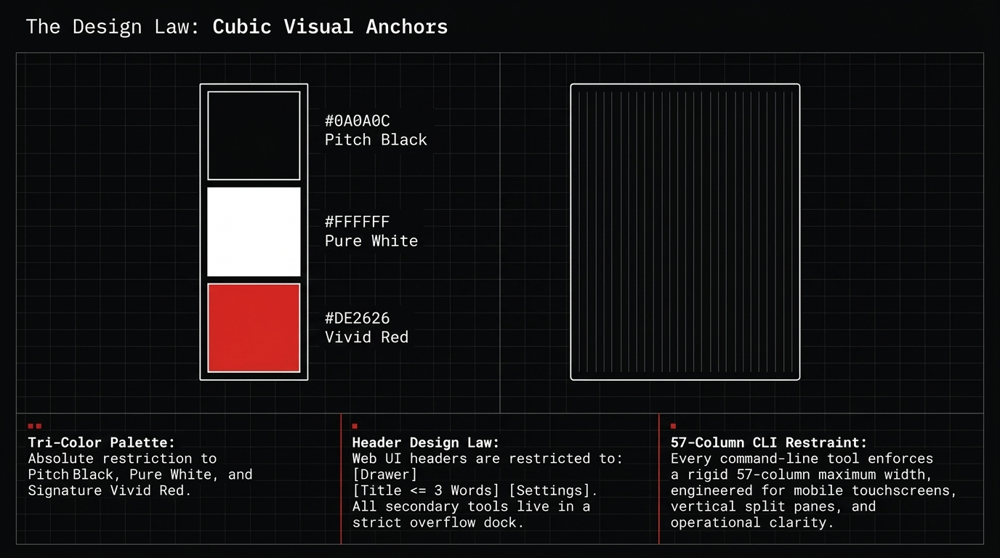
</div>

---

## Ecosystem Platforms & Developer Suites

```text
                           +-------------------------+
                           |      boehnenelton       |
                           |  Ecosystem Master Hub   |
                           +------------+------------+
                                        |
        +------------------+------------+------------+------------------+
        |                  |                         |                  |
+-------v------+   +-------v------+          +-------v------+   +-------v------+
|  BEJSON_CMS  |   |    CLI_AI    |          |   NewAgent   |   |  Management  |
|   Flagship   |   | Profile_Chat |          |  JobMaker &  |   |     Tool     |
|  Publishing  |   | Interactions |          | Agent Suite  |   |  Maintenance |
+--------------+   +--------------+          +--------------+   +--------------+
        |                  |                         |                  |
+-------v------+   +-------v------+          +-------v------+   +-------v------+
| BKS-1 Blog & |   | 12-Key Pool  |          |   Project    |   |   Reminder   |
| PageEditor   |   | & Web Canvas |          | Chunker V180 |   |     Tool     |
+--------------+   +--------------+          +--------------+   +--------------+
```

<div align="center">
  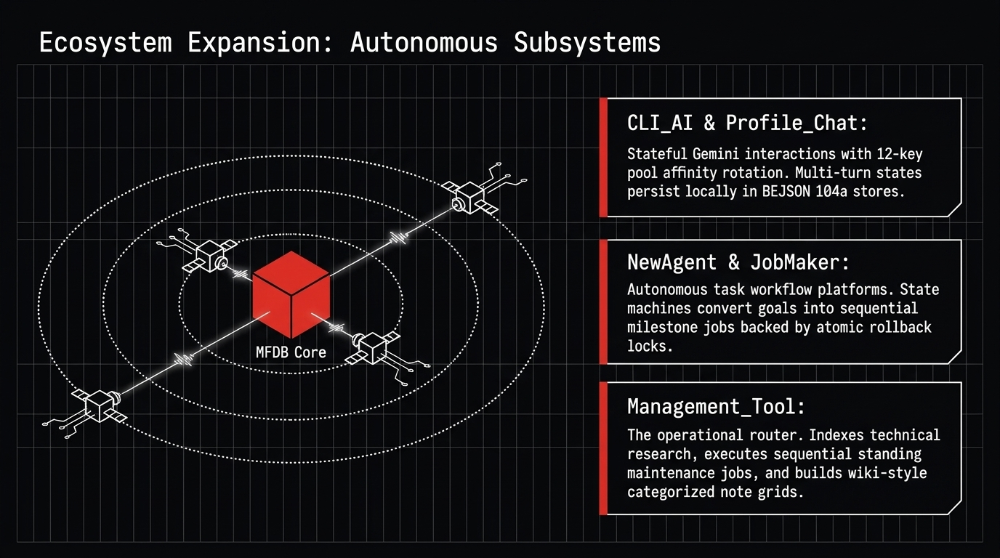
</div>

### 1. `CLI_AI` & `Profile_Chat` — Stateful Gemini Interactions & Multi-Provider Suite
- **Repository**: [`CLI_AI`](https://github.com/boehnenelton/CLI_AI)
- **Role**: Multi-provider AI CLI and web workspace (`ProfileChat-Standard.py`) powered by the Google Gemini Interactions API (`v1beta/interactions`).
- **Key Capabilities**:
  - **Server-Side Conversation Chaining (`previous_interaction_id`)**: Tracks multi-turn stateful conversations through `lib_bejson_AI_chat_interactions_engine.py` and `lib_bejson_AI_interactions_bubble.py`.
  - **Session Key Affinity & Cross-Key Local Context Re-Seeding**: Pins active sessions to the originating API key (`preferred_api_key`). When a key rotates across the 12-key pool (`ENV:GEMINI_KEY_1..12`) due to rate limits (`HTTP 429`), the engine automatically drops the previous key's `previous_interaction_id` and re-seeds the new interaction from locally persisted BEJSON session history (`local_history`).
  - **Web Preview Canvas & Gitignored Telemetry**: Includes a live HTML/SVG preview canvas (`#view-canvas`), `google_search` grounding, `code_execution`, and gitignored BEJSON `104a` session stores.

### 2. `Management_Tool` — System Maintenance & Notes Hub Suite
- **Repository**: [`Management_Tool`](https://github.com/boehnenelton/Management_Tool)
- **Role**: Central operational router, standing maintenance registry, and categorized notes portal.
- **Subsystems**:
  - **Structured Logging (`MD2HTML`)**: Transforms operational markdown notes into self-contained HTML reports.
  - **Research Reports Indexer**: Indexes and audits technical architectural research documents across storage tiers.
  - **Categorized Notes Hub**: MFDB-backed note management system with wiki-style 2-column `Categories` grids, full-text search, and static HTML export.
  - **Sequential Job Processor (`job_tool.py`)**: Executes standing maintenance tasks (`maintenance_jobs_registry.104a.bejson`) and urgent job queues.

### 3. `NewAgent` & `JobMaker` (`v1.2.15 / PKG 135`) — Autonomous AI Coding Assistant & Task Execution Platform
- **Repository**: [`NewAgent`](https://github.com/boehnenelton/NewAgent)
- **Role**: Ground-up, asynchronous AI coding assistant, autonomous task execution engine, and multi-interface orchestration platform engineered for Linux and Android Termux ARM64 environments.
- **Core Stack**: Python 3.10+, Dual AI Engine (REST + Google Interactions API), BEJSON 104a / MFDB v1.40 Persistence, 57-Column Positional Telemetry TUI, Flask Web Portal.

<div align="center">
  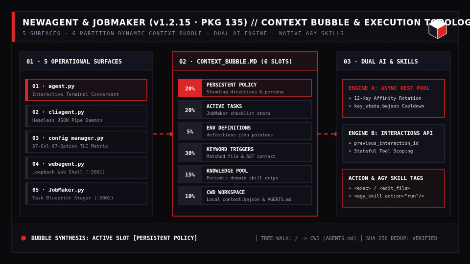
</div>

*Animation Source: [`assets/newagent_context_bubble_anim.svg`](assets/newagent_context_bubble_anim.svg) · [`dev/generate_contextual_animations.py`](dev/generate_contextual_animations.py)*

- **Five Coordinated Operational Surfaces**:
  1. **`agent.py` (Interactive Terminal Agent)**: Multi-turn conversant featuring live context bubble assembly, action tag execution (`<exec>`, `<edit_file>`, `<create_file>`), autonomous auto-continue loops, and data-driven slash commands.
  2. **`cliagent.py` (Headless Scriptable Daemon)**: Zero-overhead CLI designed for pipelines, shell pipes, and background cron scripts with structured JSON output, exit code guarantees, and timeout enforcement.
  3. **`config_manager.py` (57-Column Positional Configuration Manager)**: High-density terminal dashboard organizing all **67 system settings** across 7 domain categories (`ENG`, `AUT`, `MEM`, `EXT`, `SYS`, `BUB`, `CLI`) with one-key toggles, numbered presets (`1..9`), and graphical Android `termux-dialog` file picker integration.
  4. **`webagent.py` (Web Terminal & Settings Portal)**: Browser-based terminal serving an interactive command shell, task job runner, auto-saving notes panel, and configuration controls authenticated via URL-safe tokens.
  5. **`JobMaker.py` (Offline Job Creation System)**: Dedicated web interface to define autonomous task cards, verify goal criteria contracts, and stage BEJSON 104a job manifests with atomic rollback locks.
- **Dual AI Execution Engines & Provider Routing**:
  - **Asynchronous Multi-Key REST Engine (`engine_mode: rest`)**: Direct stdlib REST client communicating with standard endpoints without external SDK overhead. Features a 12-key affinity pool with automated rotation and circuit breaker cooldown tracking recorded in `config/key_state.bejson`.
  - **Google Interactions Stateful Engine (`engine_mode: interactions`)**: Server-side conversation chaining via `previous_interaction_id`, stateful function calling, and parameterizable tool scoping (`native_tools_scope: all | shell_only`).
- **Dynamic Context Bubble Memory Engine (`lib_bejson_newagent_context_bubble.py`)**:
  - Dynamically synthesizes budget-quantized prompt payloads (`Context_Bubble.md`) on every conversational turn across 6 weighted partitions:
    - `pct_persistent_policy` (20%): Standing directives, core persona, and identity rules.
    - `pct_active_tasks` (20%): Task context from active job checklists.
    - `pct_env_file` (5%): Live environment variables and definitions.
    - `pct_keyword_triggers` (30%): Code and file context triggered by matched query keywords.
    - `pct_knowledge_pool` (15%): Periodic knowledge pool drips.
    - `pct_cwd_context` (10%): Local workspace context (`context.bejson`).
- **Hierarchical Tree-Walking Persistent Directives**:
  - Traverses from root `/` down to the active working directory (`CWD`), dynamically discovering and merging `AGENTS.md` and `agents.md` instruction files with cryptographic SHA-256 deduplication and leaf budget reservation.
- **Native Antigravity (`agy`) Skills Compatibility Layer**:
  - Automatically discovers `SKILL.md` bundles across configured skill catalogs (`~/.gemini/config/skills`), injects instruction briefs into the bubble, and executes `<agy_skill action="list|read|run" .../>` tags during agent execution.
- **Bundled NewAgent CMS (`tools/NA-CMS/`)**:
  - Modular 5-cube local-first site management architecture (Site, Content, Media, Interface, Configuration) backed by MFDB v1.40 tables and static publishing build console.

#### Operational CLI Workflows & Launch Surfaces

```bash
# 1. Launch interactive coding conversant with live context bubble & action execution
python3 agent.py

# 2. Run one-shot headless automated prompt with structured JSON output and timeout
python3 cliagent.py --prompt "Audit the current workspace for dead functions" --execute

# 3. Launch the 57-column positional terminal configuration manager (67 options)
python3 config_manager.py

# 4. Start the authenticated browser web terminal portal on loopback
python3 webagent.py --port 5001

# 5. Launch the offline task card workflow and job staging dashboard
python3 JobMaker.py --port 5002
```

---

### 4. `Project_Chunker` (`v1.8.0 / PKG 114`) — Dual-MFDB Project Archiving, Snapshot Database & Atomic Scoop Engine
- **Canonical Environment Pointer**: `$PROJECT_CHUNKER_ROOT` (`Admin/System/Project_Chunker`)
- **Role**: Enterprise-grade, local-first, file-backed project management, filesystem snapshot archiving, and database engine engineered for Linux workstations and Android Termux ARM64 environments.
- **Core Stack**: Python 3.10+, BEJSON 104a, Dual-MFDB Architecture, Streaming 64 KB SHA-256 Hashing, 57-Column TUI Menu, Multi-Service Flask Portal.

<div align="center">
  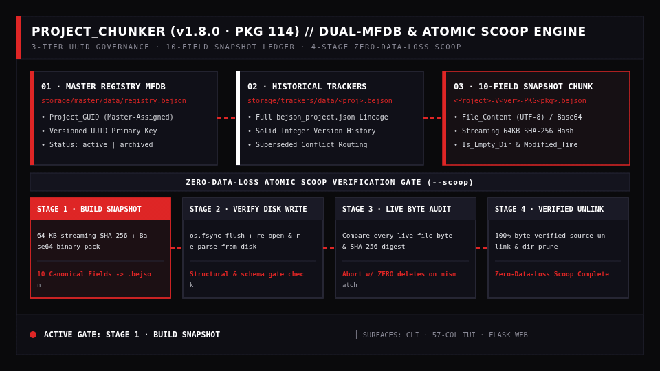
</div>

*Animation Source: [`assets/project_chunker_scoop_anim.svg`](assets/project_chunker_scoop_anim.svg) · [`dev/generate_contextual_animations.py`](dev/generate_contextual_animations.py)*

- **Architectural Philosophy & Design Principles**:
  - **Local-First File-Backed Persistence**: Eliminates heavy database server daemons, configuration drift, and network dependencies by storing complete filesystem snapshots in deterministic BEJSON 104a files.
  - **Deterministic Immutability & Streaming Bit-for-Bit Verifiability**: Once written, snapshot chunk files are immutable; every captured file carries an independent streaming 64 KB SHA-256 cryptographic hash.
  - **Zero Path Assumptions**: Self-locates execution root via `Path(__file__).resolve().parent.parent` without hardcoded path dependencies.
- **3-Tier Relational Identity Governance Matrix**:
  - **`Project_GUID`**: Globally unique ecosystem identifier assigned exclusively by master registration tooling (`cli_project_register.py`). Project Chunker **never** auto-generates or mutates a global `Project_GUID`.
  - **`Session_Id`**: Standard UUIDv4 isolating individual CLI, menu, or web transactions.
  - **`Versioned_UUID`**: Cryptographic UUIDv4 primary key bound to `Project_Version` + `Package_Version`, linking the Master Registry, Tracker DB, and Snapshot Chunks.
- **Dual-MFDB Architecture & 3-Pillar Data Model**:
  1. **Master Registry (`storage/master/data/registry.bejson`)**: Fast dictionary-cached index mapping `Versioned_UUID` to relative tracker paths, project status (`active`, `archived`, `superseded`), and registration timestamps.
  2. **Historical Tracker Plane (`storage/trackers/data/<project>.bejson`)**: Preserves the complete historical lineage of all `bejson_project.json` manifests for each project across all versions.
  3. **Snapshot Chunks (`storage/project_snapshots/<project>/data/<project>-V<ver>-PKG<pkg>.bejson`)**: Packages complete physical filesystem payloads into a single table with 10 canonical fields:
     - `File_Name` (`string`): Basename of the file.
     - `File_Extension` (`string`): Extension including dot (e.g. `.py`).
     - `Relative_Path` (`string`): Normalized POSIX relative path from project root.
     - `File_Content` (`string`): Full UTF-8 text content for text files; empty string for binaries.
     - `Base64` (`string`): Standard Base64 encoded payload for binary files.
     - `File_Hash` (`string`): Hexadecimal SHA-256 hash of the unencoded file bytes.
     - `Flags` (`string`): Serialized JSON array of flags (e.g. `["Is_Binary"]`).
     - `Is_Mounted` (`boolean`): Runtime mounting flag (defaults to `false`).
     - `Modified_Time` (`string`): ISO-8601 UTC timestamp of file last modified time with microsecond precision.
     - `Is_Empty_Dir` (`boolean`): `true` for genuine empty directories; `false` for files.
- **Core Engine Algorithms & Operational Capabilities**:
  - **Streaming 64 KB Content Ingestion**: Binary read buffer computing SHA-256 hashes with microsecond-precision `Modified_Time` tracking.
  - **Binary Detection & Base64 Payload Packing**: 8,192-byte header inspection for null bytes or UTF-8 decode failure; packages binaries with Base64 encoding and `["Is_Binary"]` flags.
  - **Synthetic Empty Directory Capture**: Records genuine empty directories (`Is_Empty_Dir: true`) while intelligently suppressing filter-eliminated directories (e.g., pruned `__pycache__`).
  - **Snapshot Content Digest & Collision Detection**: Master `Chunk_Digest` hash calculated across sorted paths and hashes; routes version collisions to `storage/superseded/<project>/` when `--on-conflict backup` is active.
  - **The Zero-Data-Loss Atomic Scoop Verification Algorithm**: Multi-stage verification gate:
    1. *Stage 1: Build Snapshot* — Scan source tree, compute hashes, serialize snapshot to disk.
    2. *Stage 2: Verify Write* — Flush buffers to disk, re-open and re-parse the snapshot `.bejson` from disk.
    3. *Stage 3: Live Byte-by-Byte Verification* — For every file in the re-read snapshot, verify file exists on live disk, read live bytes, verify text/Base64 equality, and verify SHA-256 matches. **If ANY check fails, abort immediately with ZERO deletions.**
    4. *Stage 4: Verified Unlinking* — **Only after 100% of files pass live verification**, safely unlink source files and prune parent directories bottom-up.
  - **Complete Restoration & Deployment Pipeline**: Reverses chunking via `--restore <UUID>`, resolving destination targets, pre-checking collisions, reconstructing directories, decoding Base64 binaries, writing UTF-8 text, and restoring original timestamps.
- **Tri-Surface Interface Topology**:
  - **High-Performance CLI (`CLI/project_chunker.py`)**: Full flag matrix (`--chunk`, `--scoop`, `--restore`, `--verify`, `--diff`, `--audit`, `--export-zip`, `--on-conflict`).
  - **Interactive 57-Column TUI Menu (`Menu/project_chunker_menu.py`)**: Arrow-key terminal menu with integrated directory browser and action bindings.
  - **Multi-Service Flask Web Portal (`Web/project_chunker_flask.py`)**: Modular browser interface with active project context resolution, single-slot background job runner, and visual directory picker.

#### Operational CLI Workflows & Command Recipes

```bash
# 1. Capture an active project codebase into an immutable BEJSON 104a snapshot with registry tracking
python3 CLI/project_chunker.py --chunk /path/to/project --track

# 2. Perform a Zero-Data-Loss Atomic Scoop (verifies 100% of bytes before source unlinking)
python3 CLI/project_chunker.py --scoop /path/to/project --track

# 3. Audit all stored project snapshots for bit rot and verify SHA-256 integrity
python3 CLI/project_chunker.py --verify-all

# 4. Compare a live filesystem directory against its latest registered snapshot
python3 CLI/project_chunker.py --diff /path/to/project

# 5. Restore a project snapshot back to disk by Versioned_UUID (or unique 8-char prefix)
python3 CLI/project_chunker.py --restore <VERSIONED_UUID> --dest /path/to/target

# 6. Launch the 57-column interactive TUI menu with folder picker
python3 Menu/project_chunker_menu.py
```

---

### 5. `Reminder_Tool` (`v1.0.0`) — Authoritative BEJSON 104a Reminder Management Engine & Termux `~/.bashrc` Launch Hook
- **Repository**: [`Reminder_Tool`](https://github.com/boehnenelton/Reminder_Tool)
- **Canonical Environment Pointers**: `$REMINDER_TOOL_ROOT` (`tools/reminder_tool/reminder_tool.py`) · `$REMINDERS_REGISTRY` (`data/reminders.104a.bejson`)
- **Role**: Authoritative BEJSON `104a` reminder management engine, conversational AI task queue, and interactive Termux startup banner engineered with strict 57-column portrait discipline and zero-noise empty state governance.

<div align="center">
  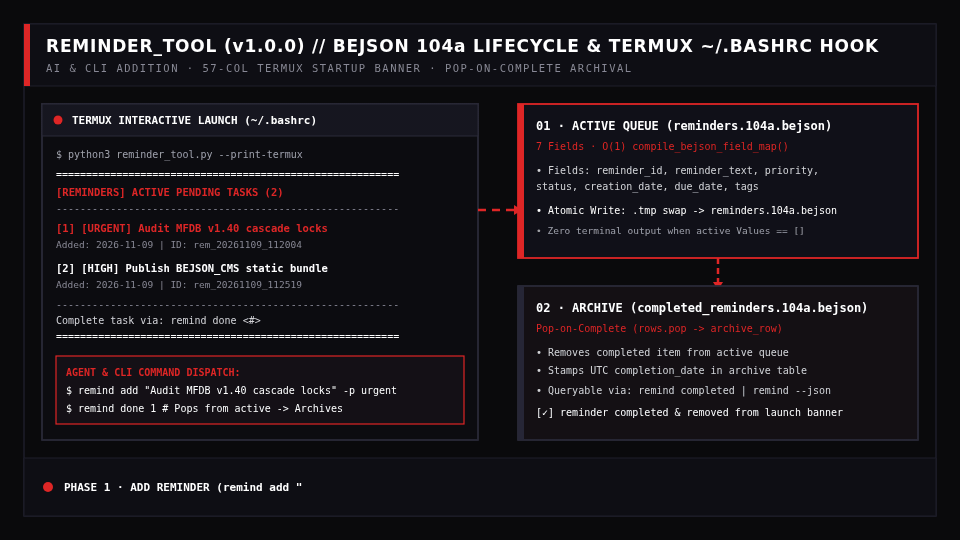
</div>

*Animation Source: [`assets/reminder_tool_termux_anim.svg`](assets/reminder_tool_termux_anim.svg) · [`dev/generate_contextual_animations.py`](dev/generate_contextual_animations.py)*

- **Dual BEJSON `104a` Registry Architecture**:
  1. **Active Reminders Queue (`data/reminders.104a.bejson`)**:
     - Stores only currently pending tasks across **7 canonical columns** resolved via `compile_bejson_field_map()`:
       - `reminder_id` (`string` — UTC timestamp slug `rem_YYYYMMDD_HHMMSS`)
       - `reminder_text` (`string` — task message content)
       - `priority` (`string` — `urgent`, `high`, `normal`, `low`)
       - `status` (`string` — `active`)
       - `creation_date` (`string` — ISO-8601 UTC creation timestamp)
       - `due_date` (`string` — optional deadline or target date)
       - `tags` (`string` — comma-separated classification tags)
  2. **Completed Reminders Archive (`data/completed_reminders.104a.bejson`)**:
     - Preserves historical completed tasks across **6 canonical columns** (`reminder_id`, `reminder_text`, `priority`, `creation_date`, `completion_date`, `tags`).
- **Pop-on-Complete Removal & Archival Lifecycle (`complete_reminder`)**:
  - When a reminder is marked complete (`remind done <index|id|substring>`), `ReminderEngine.complete_reminder()` resolves the target row by 1-based numeric index (`1`), `reminder_id` (`rem_20261109...`), or case-insensitive text substring.
  - It **immediately removes (`rows.pop()`) the reminder from the active `reminders.104a.bejson` queue** via an atomic `.tmp` swap (`save_bejson_atomic`) and appends the record with a UTC `completion_date` into `completed_reminders.104a.bejson`—ensuring completed tasks never clutter future terminal launches.
- **Direct Conversational AI & CLI Dispatch**:
  - Whenever an autonomous coding session or user prompt instructs *"add reminder `<text>`"* or *"remind me to `<task>`"*, the agent immediately executes `reminder_tool.py add "<text>" [-p urgent|high|normal]`.
  - When instructed that a reminder is complete, the agent executes `remind done <id|index>` to remove it from the active queue and archive it.
  - Unrecognized bare arguments (`remind "Update MFDB schema docs"`) automatically fall back to adding a `normal` priority reminder for zero-friction capture.
- **Interactive Termux `~/.bashrc` Launch Integration (`--print-termux`)**:
  - Hooked directly into `~/.bashrc` alongside the `alias remind='python3 .../reminder_tool.py'` shortcut:
    ```bash
    # ~/.bashrc — Interactive Termux Startup Reminder Banner Hook
    alias remind='python3 "$REMINDER_TOOL_ROOT/reminder_tool.py"'

    if [[ $- == *i* ]]; then
        if command -v python3 >/dev/null 2>&1 && [ -f "$REMINDER_TOOL_ROOT/reminder_tool.py" ]; then
            python3 "$REMINDER_TOOL_ROOT/reminder_tool.py" --print-termux 2>/dev/null
        fi
    fi
    ```
  - On every new Termux session launch, `--print-termux` inspects `reminders.104a.bejson`. If active reminders exist, it renders a high-contrast 57-column Tri-Color banner highlighting `[URGENT]` and `[HIGH]` tasks in `#DE2626` Truecolor red; if the active queue is empty (`Values: []`), it outputs **nothing** (zero terminal noise).

#### Operational CLI Workflows & 57-Column Termux Output

```bash
# 1. Add an urgent or high-priority reminder from CLI or conversational AI dispatch
remind add "Audit MFDB v1.40 cascade locks" -p urgent -t "mfdb,audit"
remind add "Publish BEJSON_CMS static bundle" -p high

# 2. Render the Termux ~/.bashrc startup banner (auto-executed on terminal launch)
remind --print-termux

# 3. Complete a reminder by 1-based index, ID, or text substring (removes from active & archives)
remind done 1

# 4. View active queue, completed history archive, or structured JSON agent context
remind list
remind completed
remind --json
```

```text
=========================================================
 [REMINDERS] ACTIVE PENDING TASKS (2)
---------------------------------------------------------
  [1] [URGENT] Audit MFDB v1.40 cascade locks
      Added: 2026-11-09 | ID: rem_20261109_112004
  [2] [HIGH]   Publish BEJSON_CMS static bundle
      Added: 2026-11-09 | ID: rem_20261109_112519
---------------------------------------------------------
  Complete task via: remind done <#>
=========================================================
```

### 6. `BEJSON_Editor` (`v1.2.9`) — Single-File Zero-Dependency Tabular & MFDB Workbench
- **Repository**: [`BEJSON_Editor`](https://github.com/boehnenelton/BEJSON_Editor)
- **Live Interactive App**: [boehnenelton2024.pages.dev/apps/bejson-web-editor/](https://boehnenelton2024.pages.dev/apps/bejson-web-editor/)
- **Latest Release**: [`v1.2.9` (PKG 169)](https://github.com/boehnenelton/BEJSON_Editor/releases/tag/v1.2.9)
- **Role**: Single-file, dependency-free browser editor and visual spreadsheet grid for BEJSON `104`/`104a` documents and MFDB `v1.31` multi-file relational database manifests.
- **Key Capabilities**:
  - **Self-Contained Browser Runtime**: Operates completely offline with zero external CDNs, npm bundles, or server dependencies.
  - **Strict CSP Security**: Validated SHA-256 script hashing meta tag with zero `'unsafe-inline'` evaluation.
  - **Web Crypto Encryption**: Client-side AES-256-GCM cipher and PBKDF2-SHA256 key derivation for sensitive cell encryption.
  - **Relational MFDB Linking**: Interactive inspector and editor for `104a.mfdb.bejson` manifests and related tabular entities.

---

## Cubic Architecture Visual Anchors

The visual identity of the ecosystem is anchored by the **3D Isometric Cube** taxonomy:

| Architecture Style | Era / Paradigm | Visual Signature | Functional Purpose |
|---|---|---|---|
| **Format 104** | Foundational Standard | Single Open Isometric Cube | Base single-table schema representation |
| **Format 104a** | Dynamic Schema Matrix | Hovering Diamond Cap (Harmonic Float) | Schema registry integration & animated vector engines |
| **Format 104db / MFDB** | Relational Multi-Table | Stacked Interlocking Dual Cubes | MFDB multi-file databases and foreign key cascades |
| **Architectural Light** | High-Contrast Daylight | White Substrate & Sharp Borders | Editorial documentation, light themes, and print |

<div align="center">

| Canonical 104 | Format 104a (Dynamic) | Format 104db (MFDB) | Light Minimal |
|:---:|:---:|:---:|:---:|
|  |  |  |  |

</div>

---

## System Error Registry & Quality Gates

The `lib_bejson_Core_bejson_validator.py` and `lib_bejson_Diagrams_diagrams_validator.py` modules enforce deterministic error codes across all ecosystem platforms:

| Error Code Range | Subsystem Category | Invariant Enforced | Failure Remediation |
|---|---|---|---|
| `E01` – `E09` | Document Root & Header | Valid JSON syntax, Header dict existence, Format tag | Re-parse raw text, reconstruct Header block |
| `E10` – `E19` | Fields Schema Array | Array shape, string names, no duplicate field names | Strip whitespace, deduplicate identifiers |
| `E20` – `E29` | Tabular Data Rows | Matrix consistency: `len(row) == len(Fields)` | Pad missing columns or reject corrupt row |
| `E30` – `E39` | Type Conformance | Primitive validation (`string`, `integer`, `number`, `boolean`)| Coerce types or reject malformed values |
| `E40` – `E49` | MFDB Manifests | `104a.mfdb.bejson` root presence, valid entity list | Regenerate manifest from filesystem scan |
| `E50` – `E59` | Referential Integrity | Foreign key target existence (`fk_target_entity`) | Apply `ON DELETE CASCADE` or block write |
| `E90` – `E95` | Format 105 Integrity | Valid UUIDv4 at column 0, matching SHA-256 hash | Re-mint UUID or flag ledger tampering |
| `E_DIAG_01` – `10`| Diagram Surface Geometry | 50px grid snap, 40px bounding clearance, valid flow | Auto-quantize coordinates, purge dead links |

<div align="center">
  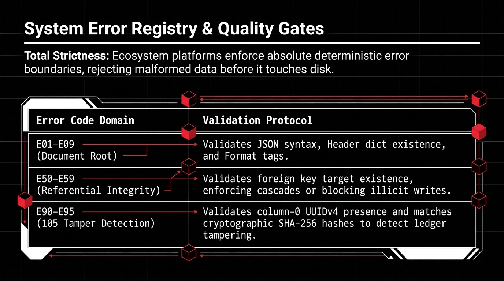
</div>

---

## Technical Specifications & Storage Standards

```text
Standard Parameter         Specification
-------------------------  -------------------------------------------------------------
Substrate Operating System Linux (x86_64 / ARM64), Android Termux (Bionic libc)
Core Programming Language  Python 3.10+ (Standard Library Centric)
Polyglot Runtimes          TypeScript (Node.js/Bun), JavaScript (Web Crypto), POSIX Bash
Data Interchange Standard  BEJSON 104a (Tabular Rows) & Format 105 (UUIDv4 Hash Chains)
Database Paradigms         MFDB (Multi-File Relational File Databases)
Terminal Geometry          57-Column Mobile Portrait Ceiling
Web User Interface         Tri-Color Palette (#0A0A0C, #FFFFFF, #DE2626), Sharp Borders
Build Pipelines            Headless Chromium Automation, Pillow/FFmpeg WebP & GIF Encode
```

<div align="center">
  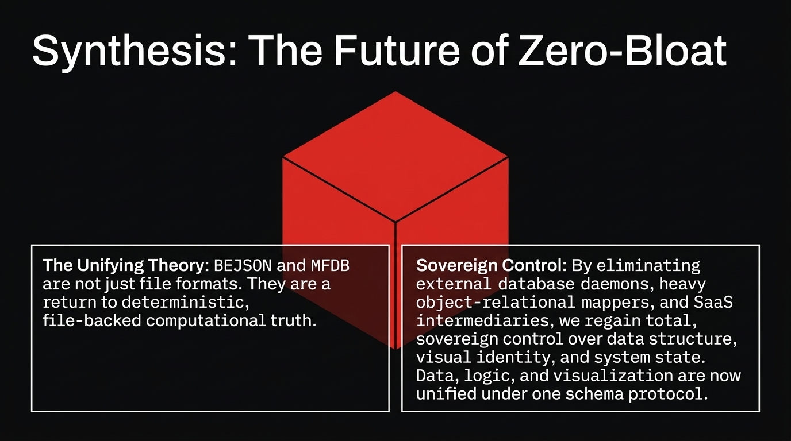
</div>

---

## Author & Verification

- **Author**: Elton Boehnen
- **Email**: [boehnenelton2024@gmail.com](mailto:boehnenelton2024@gmail.com)
- **Web Portal**: [boehnenelton2024.pages.dev](https://boehnenelton2024.pages.dev)
- **GitHub**: [github.com/boehnenelton](https://github.com/boehnenelton)

---

### License & Attribution

Distributed under the **PolyForm Noncommercial License 1.0.0** ([`LICENSE`](LICENSE) · [SPDX: PolyForm-Noncommercial-1.0.0](https://polyformproject.org/licenses/noncommercial/1.0.0)).  
Copyright (c) Elton Boehnen. All rights reserved.

This software is licensed strictly for personal, research, educational, and noncommercial purposes. Commercial exploitation, service re-hosting, or proprietary redistribution requires explicit written authorization from the author.
